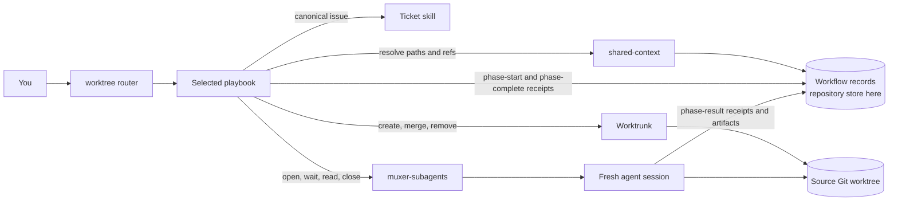
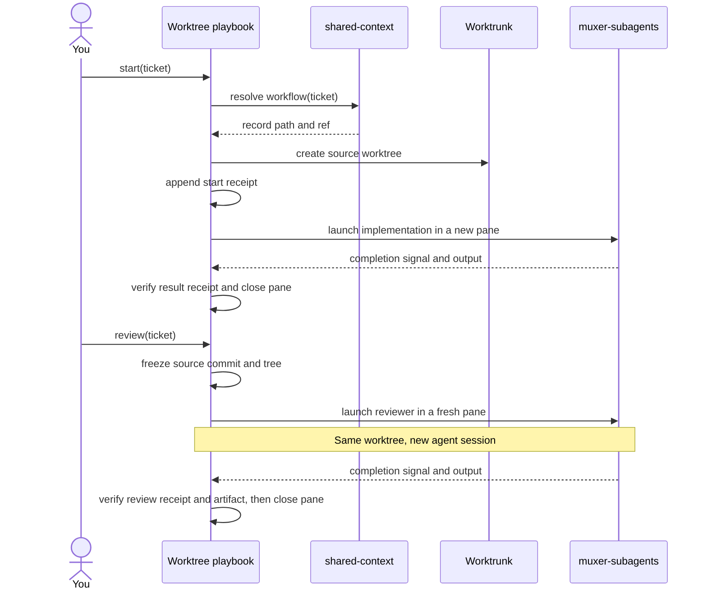
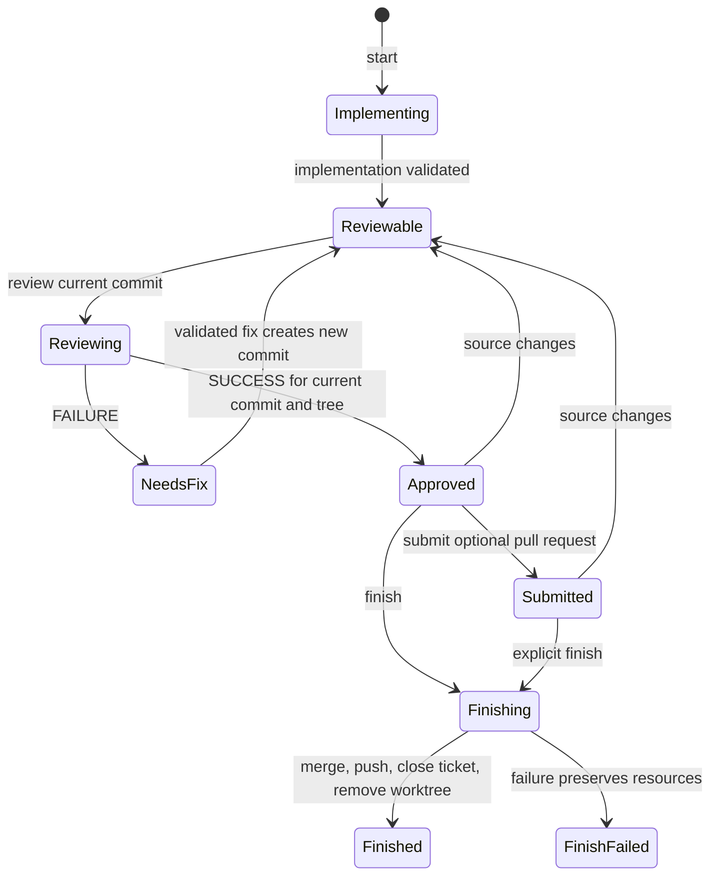

# Worktree workflow diagrams

## 1. Component map — who owns what

This view separates workflow control, record locations, agent sessions, and Git operations.



## 2. Sequence diagram — what happens when you act

This view makes the key session rule visible: implementation and review use **different agent sessions in the same source worktree**. A completion signal prompts receipt verification; it is not the durable workflow record.



## 3. State diagram — what permits the next command

This view exposes the safety rule a sequence can hide: **a review verdict applies only to its recorded source commit and tree**. A fix or later source change requires another review. Submission is optional; `finish` can follow a successful review directly or a submitted pull request.



## Live Node Workshop

The [Vite Node Workshop](diagram-gallery/) presents these three diagrams as full-width blocks. It reads their Mermaid source from this file through `mq`. The component map is draggable and zoomable with React Flow; the session handoff and review gates remain Mermaid.

Run it from `diagram-gallery/`:

```sh
bun install
bun run dev
```

Open `http://127.0.0.1:4389/`. On narrow screens, scroll inside each diagram frame to see the full diagram.


## Shared-context Graph continuity explorer

Live updates run only while the modal is open. Ticket selection watches the
selected ticket, its transitive dependents, and its direct blockers. Initiative
selection watches its members and their prerequisite closure. Collection-level
watches discover new dependency edges outside the focused scope. Shared
descendants use one subscription. Receipt changes refresh only the affected
workflow, without refetching the tracker or moving the selected receipt.

Filesystem notifications are debounced for 200 ms, with a one-second maximum
delay during continuous changes. A five-second metadata scan recovers missed
notifications and missing or replaced directories. Focused worktree HEAD checks
run every five seconds. GitHub tracker polling runs every 60 seconds; local
receipt updates do not trigger a GitHub tracker fetch. `R` remains a full reload.
Route and layout changes rebuild the subscriptions from resolved paths.

The Files tab watches its open directories and selected preview. Atomic file
replacement updates the preview without changing selection or its scroll
position. Tracker monitoring continues while the Files tab is active.

Refresh failures retain the last displayed records and show an error. Worktree
actions remain disabled while data is refreshing or the tracker is stale.
Closing the modal stops watchers and timers and prevents late render requests.

The event list includes invalid receipts instead of stopping at the first error.
Select an invalid event to inspect its stable reference, validation error, and
recorded fields. Parse failures remain listed with their file reference.
Invalid history blocks worktree actions and does not establish source freshness.
Existing events remain append-only; inspection does not repair or rewrite them.

Phase-start events can use `status: started`. Phase-start and phase-complete
envelopes can omit an evidence run; phase-result receipts still require one.
The receipt producer must copy `workflow.root` from the resolver store root,
not its workflow directory path.

The extension supports Pi 1.1 or later and oh-my-pi. Run `/reload` after updating it.

Open `/shared-context` or press `Ctrl+Shift+G`. The shortcut opens the modal directly; it does not send `/shared-context` as chat text or replace the editor draft. The titlebar shows the repository name and shared mode. Tracker and Files tabs sit below it. Press `1` for Tracker or `2` for Files. Tab highlights Tracker, Files, then returns focus to the content. Space or Enter activates the highlighted tab without opening a record. Switching tabs preserves both views. `/shared-context files` opens the Files tab directly. The initial Home view lists ready work and initiatives. It reads the configured tracker, not the preview's sample records.

Ticket rows show the frontmatter `type`, or the GitHub issue type, separately from the computed workflow state such as `[READY]`. Missing types show `[Ticket · type unspecified]`. Ticket detail also shows the type. Initiative rows show `[Initiative]`. Generated groups such as Unassigned show `[Collection]`. These labels do not depend on color.

| Control | Behavior |
| --- | --- |
| `5`, `6`, `7`, `8` on Home | Ready, review/workflow actions, blocked/unknown, or all tickets |
| Up / Down | Select a record in the active navigation pane |
| Right / Enter | Drill into the selected initiative, ticket, or receipt |
| Left / Escape / Backspace | Restore the parent column and selection |
| Shift+Tab | Cycle list, detail, and receipt dependency context |
| Page Up / Page Down | Scroll detail or page through navigation records |
| `a` | Show actions and each unavailable action's reason |
| `h`, `R`, `q` | Home, refresh authoritative records, or close |
| `b` | Browse raw files; close that browser to return to the explorer |

Initiatives show their tickets with directed dependency edges. `A → B` means B depends on A. Drilling right removes full parent columns from the viewport and gives their space to detail. Receipt inspection keeps a compact dependency neighborhood beside the receipt list and evidence. Pi redraws text panes; it does not use the browser demo's pixel animation.

At narrow terminal sizes, one pane is visible. Right / Enter opens detail from its list. Tab can reveal the receipt list, exact evidence, and dependency context. Left first restores the list, then the parent level. Full object IDs wrap without dropping characters.

### Fresh-chat actions

| Target | Keys and commands |
| --- | --- |
| Initiative | `m` ask-matt with a required prompt; `t` to-tickets; `g` grill-with-docs |
| Ticket | `m` ask-matt; `s` worktree start; `r` review; `x` fix; `f` finish; `u` submit |

Each action shows its canonical record and handoff before it opens a fresh session. The extension waits for the session transition to finish before it places the command in the **new chat's editor**. Press Enter there to run it. The explorer does not auto-send a model request or run a worktree command. The worktree skill still owns independent implementation/reviewer/fixer processes and phase side effects. Cancel returns to the explorer without launching a chat. Session errors include the underlying cause. If the session opens but editor preparation fails, the error states that the new session is already open.

Missing skills disable their actions. Unassigned is a browsing group, not a planning initiative. Preserve a durable planning handoff before splitting unfinished initiative work across chats.

### Tracker and receipt boundaries

- **Configured sources:** The backend in the resolved alignment root's `docs/agents/issue-tracker.md` must agree with the ticket route. Supported explorer backends are `local-markdown` and `github`. Local collection paths and workflow stores come from shared-context resolution.
- **Dependency integrity:** Missing blockers and cycles fail explicitly. Completed blockers do not prevent start. Unknown or unrecognised tracker states never become ready work.
- **Receipt authority:** Only append-only `events/` records determine workflow state. Manifests, projections, chat output, and closed panes do not prove completion.
- **Review freshness:** The inspector shows receipt and current commit/tree IDs. Finish and submit require a successful review of the current source. A new revision can be reviewed again. Submit does not require finish first.
- **Unavailable data:** Missing configuration, tracker failures, malformed receipts, and unavailable worktrees produce visible errors. They do not generate sample records or pretend that a ticket is ready. `b` and `/shared-context files` remain available without tracker data.

`/shared-context files` retains the original column file browser, `y` path insertion, and `f` path-format selection. `/shared-context report` and `/shared-context init [--preset hosted-shared]` keep their existing roles. Opening the explorer never initializes storage, changes tickets, or writes workflow receipts.

Run the extension regression tests from the repository root:

```sh
bun test mise/conf.d/devtools-agent/bundles/agent-core/extensions/pi-shared-context/
```

