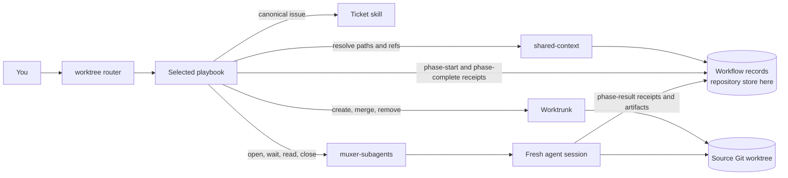
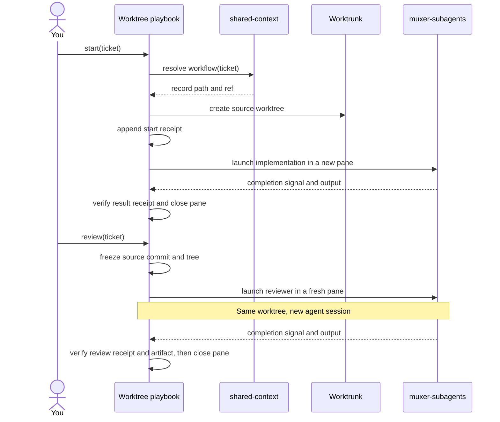
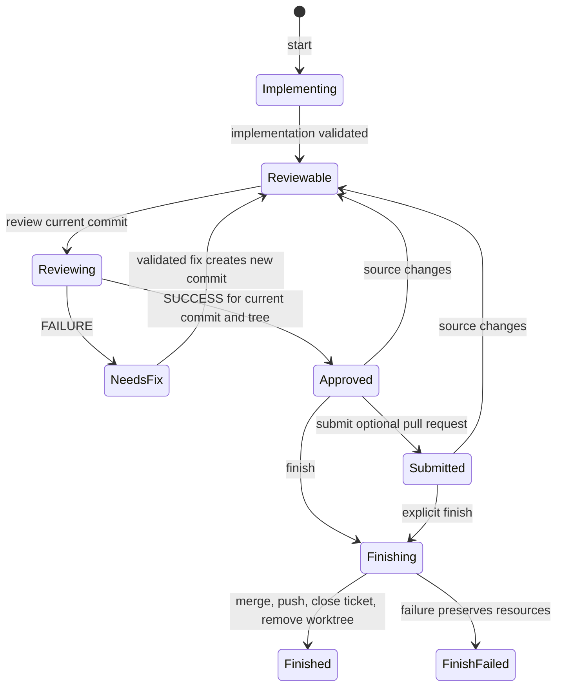

# Worktree workflow diagrams

## 1. Component map — who owns what

This view separates workflow control, record locations, agent sessions, and Git operations.



## 2. Sequence diagram — what happens when you act

This view makes the key session rule visible: implementation and review use **different agent sessions in the same source worktree**. A completion signal prompts receipt verification; it is not the durable workflow record.



## 3. State diagram — what permits the next command

This view exposes the safety rule a sequence can hide: **a review verdict applies only to its recorded source commit and tree**. A fix or later source change requires another review. Submission is optional; `finish` can follow a successful review directly or a submitted pull request.



## Live Node Workshop

The [Vite Node Workshop](diagram-gallery/) presents these three diagrams as full-width blocks. It reads their Mermaid source from this file through `mq`. The component map is draggable and zoomable with React Flow; the session handoff and review gates remain Mermaid.

Run it from `diagram-gallery/`:

```sh
bun install
bun run dev
```

Open `http://127.0.0.1:4389/`. On narrow screens, scroll inside each diagram frame to see the full diagram.


## Shared-context Graph continuity explorer

Live updates run only while the modal is open. Ticket selection watches the
selected ticket, its transitive dependents, and its direct blockers. Initiative
selection watches its members and their prerequisite closure. Collection-level
watches discover new dependency edges outside the focused scope. Shared
descendants use one subscription. Receipt changes refresh only the affected
workflow, without refetching the tracker or moving the selected receipt.

Filesystem notifications are debounced for 200 ms, with a one-second maximum
delay during continuous changes. A five-second metadata scan recovers missed
notifications and missing or replaced directories. Focused worktree HEAD checks
run every five seconds. GitHub tracker polling runs every 60 seconds; local
receipt updates do not trigger a GitHub tracker fetch. `R` remains a full reload.
Route and layout changes rebuild the subscriptions from resolved paths.

The Files tab watches its open directories and selected preview. Atomic file
replacement updates the preview without changing selection or its scroll
position. Tracker monitoring continues while the Files tab is active.

Refresh failures retain the last displayed records and show an error. Worktree
actions remain disabled while the selected inputs need validation. Planning
actions do not wait for unrelated workflow inspections. Closing the modal stops
watchers and timers and prevents late render requests.

The event list includes invalid receipts instead of stopping at the first error.
Select an invalid event to inspect its stable reference, validation error, and
recorded fields. Parse failures remain listed with their file reference.
Invalid history blocks worktree actions and does not establish source freshness.
Existing events remain append-only; inspection does not repair or rewrite them.

Phase-start events can use `status: started`. A receipt without a separate
evidence run can omit its evidence envelope. A supplied envelope must contain
its store and reference. Review recovery still requires a readable artifact
that names the recorded source commit.
The receipt producer must copy `workflow.root` from the resolver store root,
not its workflow directory path.

The extension supports Pi 1.1 or later and oh-my-pi. Run `/reload` after updating it.

Open `/shared-context` or press `Ctrl+Shift+G`. The shortcut opens the modal directly; it does not send `/shared-context` as chat text or replace the editor draft. The titlebar shows the repository name and shared mode. Tracker and Files tabs sit below it. Press `1` for Tracker or `2` for Files. Tab highlights Tracker, Files, then returns focus to the content. Space or Enter activates the highlighted tab without opening a record. Switching tabs preserves both views. `/shared-context files` opens the Files tab directly. The initial Home view lists ready work and initiatives. It reads the configured tracker, not the preview's sample records.

Ticket rows show the frontmatter `type`, or the GitHub issue type, separately from the computed workflow state such as `[READY]`. Missing types show `[Ticket · type unspecified]`. Ticket detail also shows the type. Initiative rows show `[Initiative]`. Generated groups such as Unassigned show `[Collection]`. These labels do not depend on color.

| Control | Behavior |
| --- | --- |
| `5`, `6`, `7`, `8` on Home | Ready, review/workflow actions, blocked/unknown, or all tickets |
| Up / Down | Select a record in the active navigation pane |
| Right / Enter | Drill into the selected initiative, ticket, or receipt |
| Left / Escape / Backspace | Restore the parent column and selection |
| Shift+Tab | Cycle list, detail, and receipt dependency context |
| Page Up / Page Down | Scroll detail or page through navigation records |
| `a` | Show actions and each unavailable action's reason |
| `v` in an initiative | Switch between Detail and DAG; retain each tab's scroll position |
| `C` | Cycle copy mode: path, Reference, id |
| `c` | Copy the selected record in the current mode |
| `i` in an initiative | Copy the initiative instead of its selected child |
| `h`, `R`, `q` | Home, refresh authoritative records, or close |
| `b` | Browse raw files; close that browser to return to the explorer |

The initiative Detail tab shows its child records. Press `d` to read the full specification. Press `v` to open the DAG tab. The DAG uses the same dependency builder and text renderer as `/skill:worktree tasks`. Direct initiative members form the roots. Indented records are blockers, including blockers outside the initiative. Missing records and cycles produce errors, not a partial replacement diagram. Switching tabs retains the child selection and separate scroll positions. Receipt inspection keeps its dependency neighborhood beside the event evidence.

At narrow terminal sizes, one pane is visible. Right / Enter opens detail from its list. Tab can reveal the receipt list, exact evidence, and dependency context. Left first restores the list, then the parent level. Full object IDs wrap without dropping characters.

### Cache and freshness

The initial watcher reconciliation starts the tracker load. The explorer does not start a second full inspection while subscriptions initialise. Changes observed during loading still receive another pass.

Each Pi or Herdr tracker refresh shares identical read-only Git, Worktrunk and GitHub observations across its ticket inspections. The shared results expire at the end of that refresh. Document reads remain uncached by this executor, so byte and collection checks still run. Action preparation and confirmation use the original executor and obtain fresh observations.


The extension keeps a bounded, session-only document cache. It hashes current file bytes with SHA-256 before it reuses parsed content. It does not treat timestamps or watcher events as proof that content is unchanged. Changed Markdown documents use one `mq` batch. Parsing uses the captured bytes that produced each hash. Concurrent readers share parsing but receive separate values.

Collection and byte checks detect additions, deletions, replacements and changes during loading. A changed collection produces an explicit error instead of publishing mixed records. Local action reads still validate the full collection before selecting related records. The document cache holds at most 2,048 entries or 32 MiB. Oversized or evicted records parse again.

Reopening the modal can show a cached snapshot immediately. It remains marked unverified until validation finishes. The footer shows the last validation time in UTC. The display cache stores no live workflow authorization. Description freshness warnings remain visible while you scroll. Filesystem watchers schedule updates; metadata reconciliation recovers missed events.

DAG results use ordered roots, the complete blocker closure and displayed node fields as their key. A description-only edit does not require a new graph. No agent session or graph CLI starts when you open the DAG tab.

### Fresh-chat actions

| Target | Keys and commands |
| --- | --- |
| Initiative | `m` ask-matt with a required prompt; `t` to-tickets; `g` grill-with-docs |
| Ticket | `m` ask-matt; `s` worktree start; `r` review; `x` fix; `f` finish; `u` submit |

Each action shows its canonical record and handoff before it opens a fresh session. Confirm to open a fresh chat and send the displayed prompt immediately, including your extra instructions and durable handoff references. No second Enter press is required. Pi sends through the replacement session context. OMP sends after its session transition completes. Session cancellation sends nothing. The worktree skill still owns independent implementation/reviewer/fixer processes and phase side effects. Cancel returns to the explorer without launching a chat. Session errors include the underlying cause. If the session opens but prompt delivery fails, the error states that the new session is already open.

Missing skills disable their actions. Unassigned is a browsing group, not a planning initiative. Preserve a durable planning handoff before splitting unfinished initiative work across chats.

Before confirmation, the extension resolves current routes and reads the selected record and its required dependencies. Workflow transitions also inspect current workflow state. After confirmation and the idle wait, it checks the inputs again. Changes to record bodies, blockers, routes, source observations, ownership or review artifact content require a new confirmation. Failed validation does not open a chat. GitHub action reads fetch connected records instead of listing the whole repository.

These checks do not lock files, agents or remote services. External state can change after an observation. The receiving worktree skill must inspect again before mutation; a cached display or confirmed handoff is not authorization.

### Tracker and receipt boundaries

- **Configured sources:** The backend in the resolved alignment root's `docs/agents/issue-tracker.md` must agree with the ticket route. Supported explorer backends are `local-markdown` and `github`. Local collection paths and workflow stores come from shared-context resolution.
- **Dependency integrity:** Missing blockers and cycles fail explicitly. Completed blockers do not prevent start. Unknown or unrecognised tracker states never become ready work.
- **Receipt authority:** Only append-only `events/` records determine workflow state. Manifests, projections, chat output, and closed panes do not prove completion.
- **Review freshness:** The inspector shows receipt and current commit/tree IDs. Finish and submit require a successful review of the current source. A new revision can be reviewed again. Submit does not require finish first.
- **Unavailable data:** Missing configuration, tracker failures, malformed receipts, and unavailable worktrees produce visible errors. They do not generate sample records or pretend that a ticket is ready. `b` and `/shared-context files` remain available without tracker data.

`/shared-context files` retains the original column file browser, `y` path insertion, and `f` path-format selection. `/shared-context report` and `/shared-context init [--preset hosted-shared]` keep their existing roles. Opening the explorer never initializes storage, changes tickets, or writes workflow receipts.

Run the extension regression tests from the repository root:

```sh
bun test mise/conf.d/devtools-agent/bundles/agent-core/extensions/pi-shared-context/
```


## Feedback display and initiative progress

Ticket rows keep workflow warnings short. Open ticket details with Enter to read full diagnostics. Open receipt events to inspect their recorded fields. Blank separators distinguish list items and detail fields. Selection keeps its background and marks only the first line of each item.

Press `d` to read the complete Markdown body on a separate padded background. Press Escape to return without changing selection.

Press `C` to select `path`, `Reference` or `id`. The mode stays selected across explorer openings in the same session. Press `c` to copy an initiative, research record, ADR or ticket. In initiative Detail, `c` copies the selected child and `i` copies the initiative. In DAG, `c` copies the initiative. Initiative paths end in `index.md`.

Reference mode uses the resolver's canonical reference: `shared://` for shared-store records, a relative path for repository records, or a hosted tracker URL. Hosted records support Reference and id, not a local path. Nested record directories remain part of copied paths and references. Generated collections have no record to copy. Clipboard failures appear in the status line. ADRs appear as separate records on Home and do not enter workflow queues. ADR selection uses its reference, so a numeric ADR ID cannot replace a ticket with the same ID.

Initiative progress counts executable tickets, not research or planning records. It shows `todo` before work starts, `completed` when every ticket is complete, and `X/Y completed` otherwise. Started work with no completed tickets shows `0/Y completed`. Empty initiatives show `todo`.


Progress classifies `open`, `todo`, `to do`, `new`, `backlog`, `queued`, `unclaimed`, and `ready` as untouched. This display classification does not authorize a workflow action. With no receipts or existing source, recovery accepts only `open`, `ready`, `todo`, `backlog`, `queued`, and `unclaimed` for an initial start. It blocks `new` and `to do` until the ticket adapter resolves their meaning. Existing history, source, ownership, blockers, and approval gates still apply. The states `implemented`, `merged`, and `reviewed` mean work has started; they do not mean completed. A malformed event remains inspectable and does not hide valid events from the same workflow.
