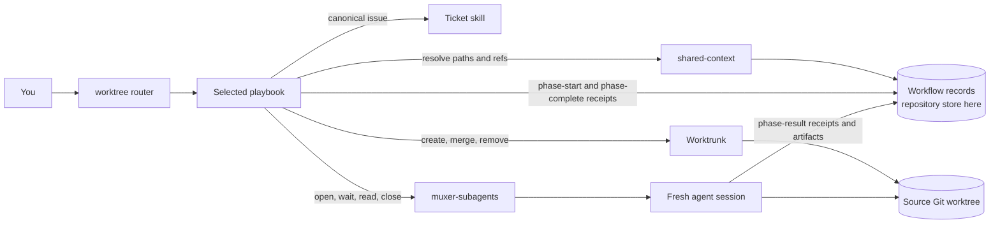
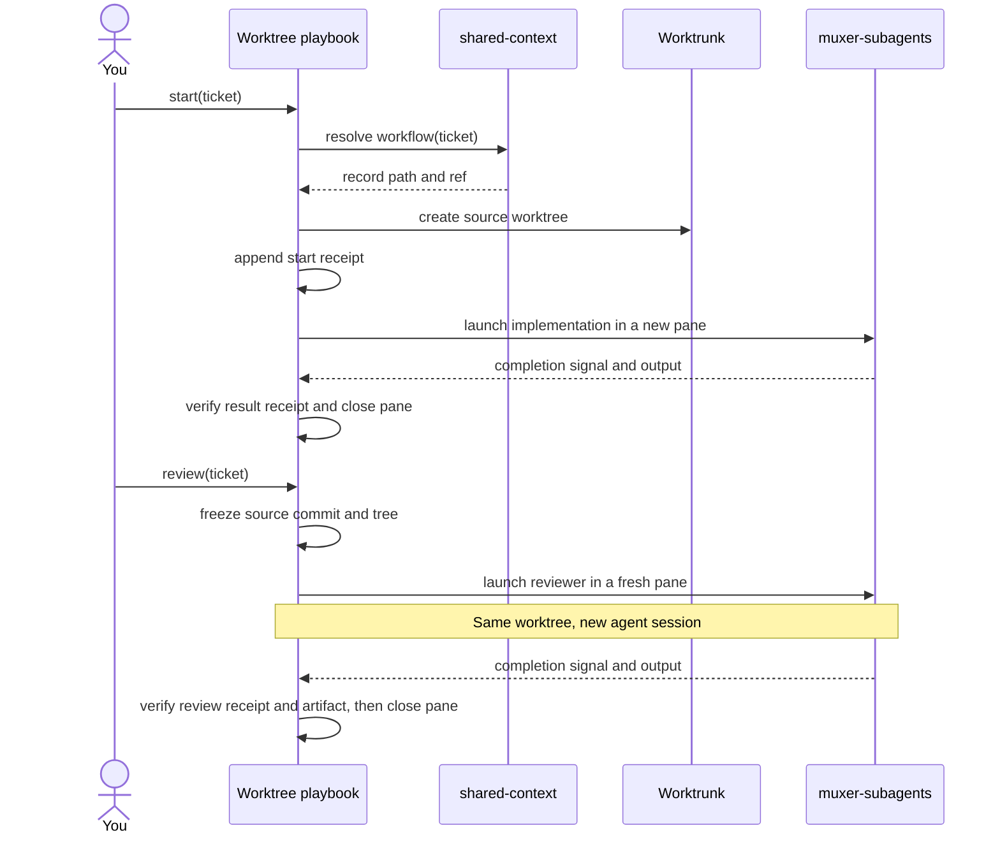
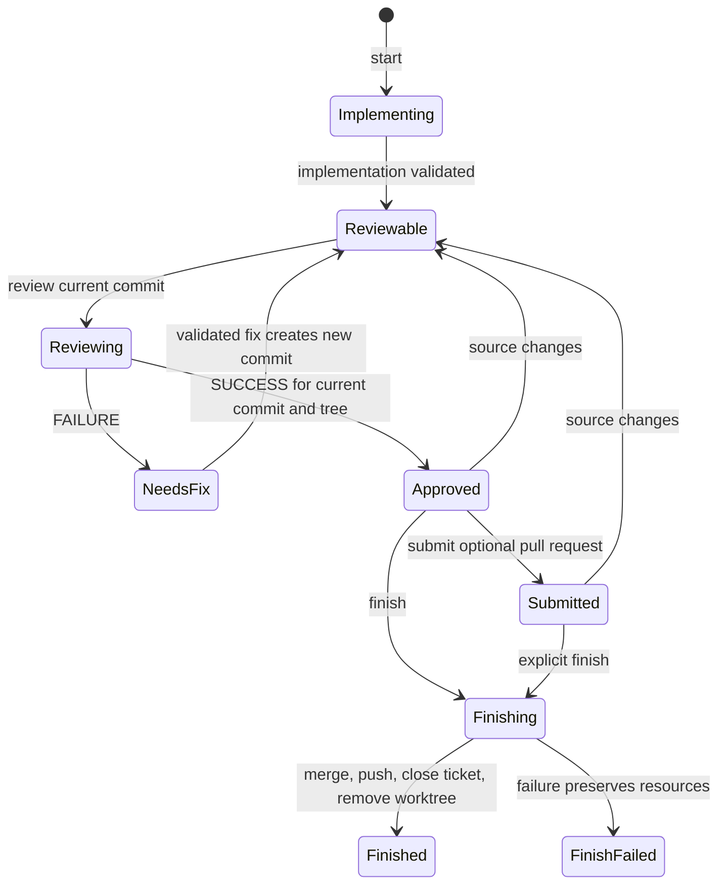

# Worktree workflow diagrams

## 1. Component map — who owns what

This view separates workflow control, record locations, agent sessions, and Git operations.



## 2. Sequence diagram — what happens when you act

This view makes the key session rule visible: implementation and review use **different agent sessions in the same source worktree**. A completion signal prompts receipt verification; it is not the durable workflow record.



## 3. State diagram — what permits the next command

This view exposes the safety rule a sequence can hide: **a review verdict applies only to its recorded source commit and tree**. A fix or later source change requires another review. Submission is optional; `finish` can follow a successful review directly or a submitted pull request.



## Live Node Workshop

The [Vite Node Workshop](diagram-gallery/) presents these three diagrams as full-width blocks. It reads their Mermaid source from this file through `mq`. The component map is draggable and zoomable with React Flow; the session handoff and review gates remain Mermaid.

Run it from `diagram-gallery/`:

```sh
bun install
bun run dev
```

Open `http://127.0.0.1:4389/`. On narrow screens, scroll inside each diagram frame to see the full diagram.
