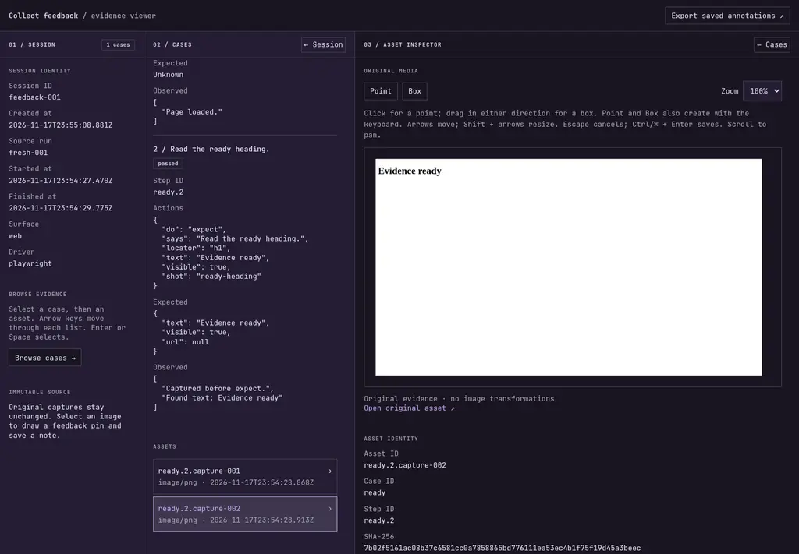

# Collect evidence and save feedback

Collect an approved workflow, save review notes, and export their source references.
For operators, reviewers, and agents. Version: collect-feedback/v1.

## Overview

Use fresh capture for current behavior. Select historical evidence explicitly for an earlier review.
A captured image does not prove a passing assertion. Saved feedback does not change ticket status.

- **Prepare current evidence:** [Prepare an approved plan](#prepare-an-approved-plan).
- **Open fresh feedback:** [Collect and open a session](#collect-and-open-a-session).
- **Review earlier evidence:** [Open an earlier run](#open-an-earlier-run).
- **Inspect source media:** [Inspect the original asset](#inspect-the-original-asset).
- **Save review notes:** [Annotate an image or recording](#annotate-an-image-or-recording).
- **Export saved feedback:** [Validate and export](#validate-and-export).
- **Stop or recover:** [Stop and reopen the server](#stop-and-reopen-the-server).
- **Look up contracts:** Read the [CLI reference](references/cli.md) or [storage and system explanation](references/system.md).

## Prepare an approved plan

Prerequisites: mise, Bun, the installed skills, a writable resolved evidence store, and the selected driver's tools and permissions.
Complete first-run dependency downloads before capture. Obtain approval for the exact surface and actions.

1. Set absolute installed paths. This example uses the OMP installation. For another harness, select its installed bundle root.

   ```sh
   BUNDLES="$HOME/.omp/agent/bundles"
   COLLECT_EVIDENCE_SKILL_ROOT="$BUNDLES/developer/skills/browsers/collect-evidence"
   FEEDBACK_SKILL_ROOT="$BUNDLES/developer/skills/browsers/collect-feedback"
   SHARED_CONTEXT_SKILL_ROOT="$BUNDLES/agent-core/skills/shared-context"
   REPOSITORY=/absolute/repository-in-scope
   WORKSPACE=/absolute/external-working-directory
   ```

2. Select the [web procedure](../collect-evidence/references/web.md), [native TUI procedure](../collect-evidence/references/tui.md), or [native GUI procedure](../collect-evidence/references/gui.md).
3. Run the driver's doctor. For GUI, supply the exact approved display, window, and title.

   ```sh
   "$COLLECT_EVIDENCE_SKILL_ROOT/scripts/collect-evidence.ts" doctor --driver playwright --json
   ```

   If default Chrome is absent, Playwright accepts `PLAYWRIGHT_MCP_EXECUTABLE_PATH` for an existing browser. Provision tools separately.
   A blocked required prerequisite stops that surface. Optional video failure does not invalidate image evidence.

4. Create a workspace outside the watched repository. Use distinct new run and session IDs.

   ```sh
   (cd "$REPOSITORY" && "$SHARED_CONTEXT_SKILL_ROOT/scripts/shared-context/cli.ts" resolve evidence --workflow review-example --run fresh-001 --json)
   "$COLLECT_EVIDENCE_SKILL_ROOT/scripts/collect-evidence.ts" init "$WORKSPACE" \
     --repository "$REPOSITORY" --workflow review-example --run fresh-001 --driver playwright --json
   ```

   The resolver's `path` is the final store location, not the external workspace.

5. Author `$WORKSPACE/plan.ts` through the selected driver procedure. Give cases purposes, preconditions, actions, expected results, and executable assertions.
6. Render the human procedure. Obtain approval for its origins, actions, confirmations, and optional video. Record that approval in the plan.
7. Compile the approved plan.

   ```sh
   "$COLLECT_EVIDENCE_SKILL_ROOT/scripts/collect-evidence.ts" render "$WORKSPACE" --json
   "$COLLECT_EVIDENCE_SKILL_ROOT/scripts/collect-evidence.ts" compile "$WORKSPACE" --json
   ```

Expected result: one approved `plan.ts`, its generated procedure and fingerprint, and a resolved destination.
For a complete runnable web example, use the [collector how-to](../collect-evidence/howto.md).

## Collect and open a session

Prerequisite: the compiled workspace repository and workflow match the request flags.

1. Inspect the request without writes or capture.

   ```sh
   "$FEEDBACK_SKILL_ROOT/scripts/collect-feedback.ts" request "$WORKSPACE" \
     --repository "$REPOSITORY" --workflow review-example --session feedback-001 --port 8091 --dry-run --json
   ```

2. Run the same command without `--dry-run`.
3. Keep the foreground process alive. Open its returned `url` on the same machine.
4. Retain `destination.path`, `destination.ref`, and `records` from the readiness event.

Expected result: the collector seals the run, the importer creates a separate session, and the server binds the explicit loopback port.
Readiness is not a passing case verdict. Assertion-only FAIL runs can open for review.
Any BLOCKED case stops the request before import, even in a mixed FAIL/BLOCKED run.
A stopped capture never silently becomes historical evidence. Retry with a new run ID.

If you already ran collector `run`, use `init` instead of collecting that identity again:

```sh
SEALED_RUN=/absolute/sealed-run
"$FEEDBACK_SKILL_ROOT/scripts/collect-feedback.ts" init "$SEALED_RUN" \
  --repository "$REPOSITORY" --workflow review-example --session feedback-002 --json
SESSION=/absolute/path/from-destination.path
"$FEEDBACK_SKILL_ROOT/scripts/collect-feedback.ts" validate "$SESSION" --json
"$FEEDBACK_SKILL_ROOT/scripts/collect-feedback.ts" serve "$SESSION" --port 8091 --json
```

## Open an earlier run

Prerequisites: an explicitly selected sealed `collect-evidence/v1` run and a new session ID.

```sh
EARLIER_RUN=/absolute/earlier-sealed-run
"$FEEDBACK_SKILL_ROOT/scripts/collect-feedback.ts" request "$EARLIER_RUN" --historical \
  --repository "$REPOSITORY" --workflow review-example --session historical-001 --port 8091 --json
```

For separate import and serve, use `init "$EARLIER_RUN" --historical` with the same store flags.
Expected result: the viewer and export label the session historical. Capture times and hashes remain original.
Unknown capture times stay unknown. Import time is not capture time.
Unsupported versions and unversioned archives fail before session creation. Existing reports and feedback remain unchanged.

## Inspect the original asset

Prerequisite: the local viewer shows a validated session.

Select a case, then select its captured image in the asset list.
Read the case results separately from the image.

[](assets/howto/original-asset.webp)

Open either screenshot for full-size detail.
This controlled example shows the settled web capture before any annotation.
The asset inspector retains the original dimensions, capture time, asset ID, and source hash.

## Annotate an image or recording

Prerequisite: the local viewer shows a validated case and registered asset.

1. Select a case and read its purpose, steps, results, and limits.
2. Select an image or WebM recording. For video, pause at the required timestamp.
3. Click for a point, or drag in either direction for a box. For keyboard creation, use Point or Box.
4. Move the mark with arrows. Resize boxes with Shift plus arrows.
5. Enter a comment. Select P1 Blocker, P2 Friction, or P3 Polish.
6. Save with the Save button or Ctrl or Meta plus Enter. Wait for Saved.

Expected result: a durable annotation binds the asset ID, hash, original dimensions, geometry, and comment.
[](assets/howto/saved-box-note.png)

The Saved label follows server acknowledgement. The box retains its source-image coordinates.

Video notes also retain the playback timestamp. They do not track objects or promise exact frames.
Zoom and scroll preserve image coordinates. Narrow screens retain horizontal inspector columns.

Select a saved pin to inspect it without a draft. Use Edit note, Delete note, or Undo deletion for changes.
Escape cancels the active draft. Undo remains available after reload or restart.
If a save fails, retain the draft and retry the same payload.
If a revision conflict occurs, compare the saved version with your draft before replacement.
Use saved revision for next save adopts the displayed revision only after your explicit choice.

Unfinished drafts recover across navigation and reload in the same tab and origin. Keep the same port.
Tab closure or a different port loses access to those tab-local drafts.
If browser storage fails, the warning means that drafts remain in memory only.

## Validate and export

Prerequisite: all comments intended for a complete review are saved or explicitly discarded.

1. Use Export saved annotations in the viewer. Resolve every unfinished draft when prompted.
2. Validate the session and export the saved records through the CLI.

   ```sh
   SESSION=/absolute/path/from-destination.path
   "$FEEDBACK_SKILL_ROOT/scripts/collect-feedback.ts" validate "$SESSION" --json
   "$FEEDBACK_SKILL_ROOT/scripts/collect-feedback.ts" export "$SESSION" --json > /absolute/external-review.json
   ```

3. Compare exported asset IDs and hashes with the selected source. Retain the session stable reference with the export.

Expected result: a `collect-feedback/v1` export contains verified sources and saved annotations, including revisions and deletion state.
CLI and direct API exports contain saved server records only. They cannot inspect browser drafts.
Export does not change source assets or saved feedback.

For a report, use the installed read-only consumer:

```sh
REPORT_SKILL_ROOT="$BUNDLES/developer/skills/devtools/writing-reports"
"$REPORT_SKILL_ROOT/scripts/report-cli.ts" evidence "$SESSION" --feedback --json
```

Without `--json`, this command prints self-contained HTML.
Store exports and reports outside the immutable evidence and feedback directories.

## Stop and reopen the server

1. Send Ctrl-C, SIGINT, or SIGTERM only to the foreground server you created.
2. Validate that its port and `.writer.lock` are released. Keep the session directory.
3. To reopen, run `serve "$SESSION" --port 8091 --json` through the same installed CLI.

Expected result: saved annotations survive the restart. A second writer or occupied port fails without a fallback.
If a crash leaves a lock, establish process shutdown before an operator removes that exact lock.
The CLI never steals a lock. Agents must register live owned resources through their muxer contract before shutdown.
Local collection and serving do not approve publication, remote Git operations, or credential entry.
