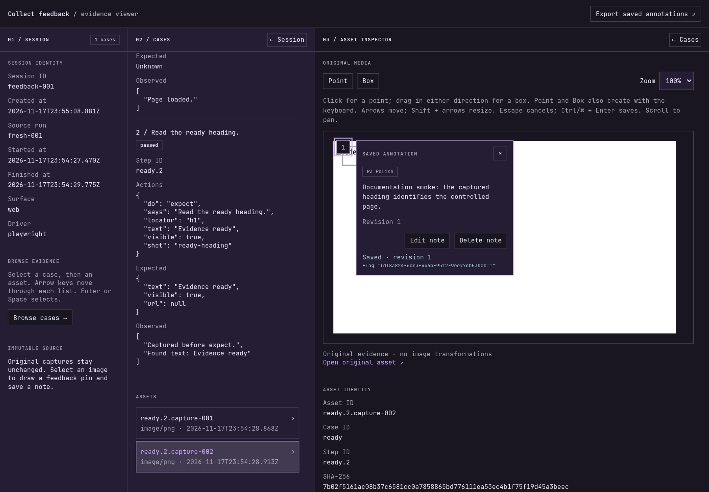

# Review your application with your coding agent

Ask your coding agent to collect evidence, then leave feedback on the captures in a local viewer.
You describe the workflow and approve the actions. The agent handles capture plans, commands, storage, and server cleanup.

## Before you start

Open your coding agent in the repository you want to review. Have the application running, or ask the agent to help start it.
The agent needs these skills available:

| Skill | When it is needed |
|---|---|
| `collect-feedback` | Opens the viewer and manages saved annotations. |
| `collect-evidence` | Collects fresh evidence and validates supported evidence runs. |
| `shared-context` | Resolves where evidence and feedback belong for this repository. |
| `reading-and-writing-tickets` | Reads ticket requirements when you provide a ticket. Standalone feedback does not require one. |
| `muxer-subagents` | Manages child sessions and owned processes when the calling workflow uses them. |
| `worktree` / `writing-reports` | Optional implementation/review lifecycle or report generation. Neither is required to leave feedback. |

You do not need to choose storage paths, run IDs, ports, or CLI flags.
Ask the agent to check skill availability, capture tools, and permissions before starting.
Missing tools need a separate setup decision, not automatic installation during capture.

The current feedback server requires Linux. The viewer runs on the agent's machine; open its local URL on that same machine.
Web, terminal, and desktop capture have different tool and permission requirements. A supported driver is not proof that it works on your machine.

## 1. Describe what you want to review

Select `collect-feedback` in your agent's skill picker, if it has one, or ask for the skill by name:

> Use collect-feedback to review the settings workflow in my running application. Check the prerequisites first. Show me the proposed steps before you capture anything, then open the feedback viewer.

Give the agent the application URL or the terminal command and directory.
Name the screens and states you care about, what should happen, and any boundaries:

> Start at http://localhost:3000/settings. Capture the empty form, validation errors, and a successful save using test data. Do not use real customer data or change account permissions.

For a ticket-backed review, include the ticket reference:

> Use collect-feedback to review the workflow described in this ticket. Read its acceptance criteria and propose a capture plan before running it.

**Expected result:** the agent identifies the repository, checks the selected capture tools, and proposes a workflow you can approve.
If a required tool or permission is missing, it explains what is blocked instead of substituting unrelated evidence.

## 2. Approve the capture

Read the proposed screens, actions, expected results, and capture scope.
Check any save, delete, submit, or other confirmation step before approving it.
A request for screenshots does not approve every action in the application.

> Capture those steps with the test data we agreed on. Stop if you encounter credentials, an unexpected confirmation, or a screen outside this scope.

The agent prepares and runs the capture behind the scenes. You do not need to author a plan file or copy commands into a terminal.
If you want a recording, ask before capture; the agent must check whether the selected driver supports it.

**Expected result:** the agent reports the observed results and limitations, then supplies the actual feedback viewer URL and a saved session reference.
Keep that reference in the conversation so you can reopen the session later.
A screenshot proves what was captured, not that every check passed. Read failures and blocked steps separately.

## 3. Open the viewer and inspect the evidence

Open the URL supplied by the agent. Select a case, read its purpose and results, then select an image or recording.
Check that it shows the state you intended to review before adding notes.

This example shows a controlled web capture. The asset inspector identifies the original capture and its source hash.
Click either screenshot in this guide to inspect it at full size.

For a recording, pause at the moment you want to discuss. Video notes retain a timestamp; they do not track moving objects or guarantee an exact frame.
If the evidence is wrong or incomplete, ask for a new capture instead of annotating it as though it were correct.

## 4. Save your feedback

1. Choose **Point** for a location, or **Box** for an area. Click or drag on the image or paused recording.
2. Enter a comment beside the mark. Describe the problem and the result you expect.
3. Choose **P1 Blocker**, **P2 Friction**, or **P3 Polish**.
4. Select **Save**, or press Ctrl or Meta plus Enter. Wait for **Saved**.

You can select a saved pin to inspect it, edit its note, delete it, or undo deletion.
For keyboard creation, use Point or Box, move with arrow keys, and resize boxes with Shift plus arrow keys. Escape cancels the active draft.

**Expected result:** a saved note stays linked to the original evidence without changing the source image.
A draft is not saved feedback. Draft recovery is limited to the same browser tab and origin; save before closing or changing the viewer URL.
If saving fails, keep the page open and retry. If another editor changed the note, compare the saved revision with your draft before replacing it.

## 5. Return to your coding agent

Save the notes you want the agent to read, then return to the conversation:

> Read the feedback I saved in this session. Group it by priority and propose fixes. Do not edit code yet.

The agent locates the session, validates its saved records, and reads or exports the notes.
You decide which changes to make. Saving feedback does not approve code edits, complete a ticket, or merge a branch.

**Expected result:** the agent connects each proposed change to your saved note and the relevant captured state.
After a fix, ask for fresh evidence to check the current behavior; the earlier capture remains unchanged.

## Export your feedback

Use **Export saved annotations** in the viewer when you want a copy.
Save or explicitly discard every unfinished draft when prompted.
You can also ask the agent:

> Export the saved feedback from this session and give me the file location and session reference. Do not publish it anywhere.

**Expected result:** the export contains saved annotations and verified source references, not unfinished browser drafts.
Local review does not authorize uploading screenshots, publishing reports, or sharing private data.

## Reopen a session or review earlier evidence

To continue with existing saved feedback:

> Reopen my previous feedback session without collecting new evidence. Use the same viewer port if I need to recover drafts in this browser tab.

Saved annotations remain in the session after the server stops. Ask the agent to stop its viewer when you finish; it should keep the saved records.

To review an earlier capture in a new feedback session, select it explicitly:

> Use collect-feedback to review this earlier evidence run. Do not collect new evidence. Clearly label it as historical.

**Expected result:** earlier evidence is labelled historical and retains its original capture times.
It does not prove what the application does now. If fresh capture fails, the agent must not silently reuse an earlier run.

## Technical details

The agent handles the commands. For manual operation or troubleshooting, use the [CLI reference](references/cli.md),
[request procedure](references/request.md), and [storage and system explanation](references/system.md).
For evidence without annotations, use [Collect evidence with your coding agent](../collect-evidence/howto.md).
