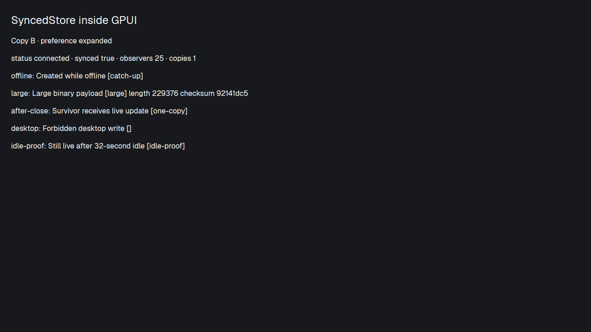

# SyncedStore inside the Herdr mod: experiment result

Verdict: **PASS for local runtime feasibility**, not production or remote-deployment readiness.

Date: 2026-11-19. Readers: Herdr shared-context maintainers.

## Conclusion

The existing GPUI mod runtime can own a real SyncedStore/Yjs replica through a transport-only WebSocket helper. Core and app changes are not required for the tested path.

The mod used the real `@syncedstore/core@0.6.0`, `yjs@13.6.33` and `y-websocket@3.1.0` packages. Bun bundled the libraries; it did not own the desktop replica. The helper imported `ws` and filesystem logging only. It forwarded opaque frames and owned no tracker projection or Yjs document.

The target rejected desktop writes before applying them. Rejection did not undo the attempted mutation in the local replica. The final screenshot deliberately retains that rejected local record. This experiment proves target authority, not automatic local rollback.

## Scope and evidence

The muxer child ran in space `finance`, tab `agent-0e31a8b3`. Run identity: `0e31a8b3-799b-45dc-a752-eb2322dde164`.

The experiment used an owned Cage headless display, the installed Herdr app, and a scratch app home. The target endpoint ran on localhost. The existing tracker mod and Core/app binaries were unchanged.

The parent verified the result-delivery identity and hash, inspected the mod/helper sources, opened the original screenshots, compared authoritative records before and after desktop write attempts, and verified final muxer shutdown. This is not a separate rerun of the child’s experiment.

The user’s app retained its original selected space, tab, pane and `zenobius` layout, with no reported errors after the experiment. The experiment child terminal was closed and removed.

Navigate: [Observed cases](#observed-cases), [Required adaptations](#required-adaptations), [Measured local timing](#measured-local-timing), [Limitations](#limitations), [Retained artifacts](#retained-artifacts), [Reproduction](#reproduction).

## Observed cases

| Case | Result | Evidence in archive |
|---|---|---|
| Actual mod loads real libraries | PASS | `final-check.log`, `app/mods/experiment/main.js` |
| Initial state reaches two rendered copies | PASS | `initial.png`, `bridge.jsonl` |
| Target creation, edit and deletion update the UI | PASS | `live.png`, `exercise.log` |
| Reconnect catches missed additions and deletions | PASS | `disconnected.png`, `reconnected.png` |
| Larger Unicode/binary update retains matching content checksum | PASS | `large.png`, `verification.json` |
| One replica/socket serves two copies; closing A leaves B live | PASS | `survivor.png`, `idle-proof.json` |
| Surviving copy still updates after more than 32 seconds idle | PASS | `idle-survivor.png`, `idle-proof.json` |
| Desktop writes do not change the authoritative document | PASS | `state-before-write.json`, `state-after-write.json` |
| Last-view close shuts the socket; owned services and child stop | PASS | `window-close-stats.json`, `ports-after.json`, `cleanup-final.json` |

The large frame contained 426,083 bytes. Its test body contained 229,376 UTF-16 code units and 425,984 UTF-8 bytes. Target and mod FNV-1a-over-UTF-16 checksums both equalled `92141dc5`. This checksum is a test-content comparison, not cryptographic integrity proof.

The final image shows copy B receiving the idle update after copy A closed. It also shows the rejected local mutation, which is not present in target state.

## Required adaptations

### Supply the missing WebSocket interface

A `WebSocketPolyfill` adapter forwards frames through a localhost HTTP helper. The helper owns the real WebSocket connection to the target. The adapter supplies lifecycle callbacks, static and instance state constants, ordered sends and ArrayBuffer conversion.

Held local HTTP requests deliver frames to the mod. This is a transport bridge, not a second tracker synchronization protocol. Yjs and y-websocket still perform document synchronization.

### Adapt timers to native view tasks

The runtime exposes `setTimeout` and `setInterval` as functions, but calling them failed during live library initialization. A `typeof` probe was therefore insufficient.

The experiment maps library scheduling to `cx.timer.after`. It cancels tasks and transfers pending timers to the surviving copy when another copy closes. These timers do not periodically refresh the tracker UI.

### Handle held-request lifetime

The runtime’s held `fetch` requests failed at about 30 seconds. The helper returns an empty frame batch after 15 seconds. The mod then waits again. Empty batches do not notify the UI or trigger a tracker read.

Each copy owns its own receive task over the shared socket. A shared sequence cursor dispatches each received frame once. A single receive task owned by copy A stopped when A closed; the final arrangement passed the surviving-copy scenario.

### Keep render work small

Computing the large body checksum during render triggered the runtime’s interrupted-render guard. The final mod computes summaries in the document observer and renders those summaries. The earlier failure remains in `second-run/large.png`.

The existing lib0 UTF-8 fallback handled Chinese and supplementary-plane characters without TextEncoder/TextDecoder polyfills.

### Close the socket through an available quit path

Ordinary fetch cleanup could be canceled during window shutdown. The adapter issues a finite `herdr.exec` call to `curl` for socket closure. This is not an exec-based frame stream. The helper recorded all sockets closed before the helper stopped.

## Measured local timing

These measurements use one host’s wall clock. They measure target publication to GPUI notification, not native frame presentation or remote-network latency.

| Operation | Publication to UI notification |
|---|---:|
| Create record | 1 ms |
| Edit record | 1 ms |
| Large Unicode update, including observer checksum work | 198 ms |
| Update after closing copy A | 35 ms |

Raw timestamps are in `timings.json`. They do not establish production latency targets.

## Limitations

- **Remote deployment:** No remote machine, TLS, authentication, firewall or production endpoint was tested.
- **Tracker collection:** The target held synthetic derived records. It did not integrate the real tracker parser, filesystem indexer or workflow derivation.
- **Rejected local writes:** Server rejection preserves target authority but leaves the local mutation visible. A read-only production interface must prevent writes or define recovery.
- **Saved replicas:** Offline persistence and restart recovery were not part of this experiment. Preferences were per-copy props, not saved settings.
- **Transport retention:** The helper retained opaque frame history for the experiment lifetime. Production retention and acknowledgements remain unresolved.
- **Serialization cost:** Local frame batches used JSON byte arrays. This proves binary transfer correctness, not efficient memory use.
- **Synthetic scale:** One larger record does not establish performance for a real multi-record tracker.

## Retained artifacts

Download the [source and original evidence archive](syncedstore-mod-experiment.tar.gz). It contains 73 SHA-256-checked original files, final source and bundle, pinned dependencies, screenshots, logs, earlier failed attempts and reproduction notes. It excludes `node_modules` and unrelated app state.

Archive SHA-256: `e7fe1a2f64f300395c284c9c59b5b962f30e4971a819777c15525e06899e7581`.

`SHA256SUMS.json` records original-file hashes. `cleanup-final.json` records confirmed shutdown after the child terminal closed. `delivery-envelope.json` preserves the reviewed handoff.

Result payload SHA-256: `f946352390cd3a23439ffcd1f07f950beda335d142a65380ada2ea3bead2ac85`.

The scratch source also remains at `/tmp/herdr-syncedstore-experiment-zymqzo4q`. The repository archive is the durable copy.

## Reproduction

Extract the archive into a fresh directory. Follow its `reproduce.txt`, adapting the original scratch path to the extracted `experiment/` directory. Install the pinned dependencies with `bun install --frozen-lockfile`.

The archive provides the final checked bundle and a minimal scratch `app/shared.json` that skips onboarding. Restore `two-copy-layout.json` before starting the isolated window. Do not rerun against the original evidence directory: the exercise writes fixed evidence filenames.

Use the installed app, Bun, Cage and curl. Start only owned target/helper/display processes. Keep the real tracker mod unchanged. Follow the recorded shutdown procedure and verify the experiment ports close.

## Related decisions

Use [the confirmed grilling decisions](replication-grilling-decisions.md) as the current scope. At experiment time, the earlier proposal contained a rejected Core-owned replica/native-subscription design. The [consolidated rewrite proposal](target-owned-tracker-replication.md) now records the agreed mod-owned design. This report retains the original experiment findings.
