# Shared-context collection systems

Map Herdr shared-context collection responsibilities and data flow for maintainers.

Date: 2026-11-19. Source revision: `c0d9a412b5a4a4ccea7331c0c824cb0119cc10bb`.

## Overview

Recommended format: Mermaid flowchart in Markdown. Nested subgraphs preserve the report’s responsibility boundaries; labelled arrows preserve its directed relationships.

This is a transcription of the [interactive system analysis](../../../docs/website/public/artifacts/devtools-herdrapp/2026-11-19-system-analysis.html), not a new audit of the current implementation. It preserves all 18 groups, 29 components and 38 relationships, plus their descriptions, notes and source references. Mermaid does not preserve React Flow’s collapse controls, selection panels or manual layout.

Navigate: [System diagram](#system-diagram), [Read lifecycle](#read-lifecycle), [Component reference](#component-reference).

## System diagram

Desktop reads pass through the query cache and selected-machine transport to canonical target loaders and routed stores. Results feed retained views; local file events trigger refresh.

Arrow legend: `-->` request, `==>` result, `-.->` refresh or cancellation. Labels retain the source report’s wording. Node identifiers replace hyphens with underscores; reference entries retain the original identifiers.

```mermaid
flowchart LR
    accTitle: Herdr shared-context collection systems
    accDescr: Desktop reads pass through a client cache and selected-machine transport to canonical target loaders and routed source systems. Results return to retained views; local file events trigger refresh.
    subgraph desktop["Desktop view"]
        subgraph acquisition["Acquire and refresh"]
            location["Target selection"]
            refresh["Refresh policy"]
            coordinator["Read coordinator"]
            hydration["Detail hydration"]
        end
        subgraph presentation["Project the results"]
            retained["Retained GPUI surfaces"]
            projections["Tree, progress and activity"]
        end
    end
    subgraph client["Desktop query cache"]
        subgraph cells_section["Read cells"]
            cells["QueryClient cells"]
            validation["Batched validation"]
        end
        subgraph durable_section["Durable display reuse"]
            local_storage["localStorage snapshot"]
            release["Release and race fences"]
        end
    end
    subgraph transport["Herdr Core transport"]
        subgraph calls_section["Request transport"]
            dispatch_client["runQuery / exec"]
            runner["Target launcher discovery"]
        end
        subgraph workers_section["Owned background work"]
            core_jobs["Core worker lifecycle"]
        end
    end
    subgraph helper["Target helper runtime"]
        subgraph protocol_section["Protocol and job files"]
            protocol["Protocol dispatcher"]
            job_files["QueryJobs state"]
        end
        subgraph canonical_cache_section["Canonical read cache"]
            target_cache["ReadCache replay"]
            observations["Observation capture"]
            read_session["Batch read session"]
        end
    end
    subgraph loaders["Canonical domain loaders"]
        subgraph context_files_section["Context and file collections"]
            context_api["Context resolution"]
            file_api["Contained file reads"]
        end
        subgraph tracker_section["Tracker and workflow collection"]
            tracker_api["Tracker / detail operations"]
            snapshot_loader["loadExplorerSnapshot"]
            documents["DocumentReadSession"]
            workflow_loader["Workflow and recovery"]
        end
    end
    subgraph sources["Routed stores and source systems"]
        subgraph stores_section["File-backed authority"]
            routes["Route and project metadata"]
            files["Repository / shared files"]
            git_events["Workflow events and Git"]
        end
        subgraph adapters_section["Other tracker adapters"]
            github["GitHub through gh"]
            jira_mirror["Jira Markdown mirror"]
        end
    end
    location -->|"machine + cwd"| coordinator
    refresh -.->|"refresh(cx)"| coordinator
    coordinator -->|"validate first"| validation
    coordinator -->|"context / tree / files"| cells
    coordinator -->|"tree before details"| hydration
    hydration -->|"detail; ≤4 readers"| cells
    cells -->|"persist / restore stale"| local_storage
    release -.->|"cancel owned work"| core_jobs
    validation -->|"validate tokens"| dispatch_client
    cells -->|"$cache: true"| dispatch_client
    dispatch_client -->|"resolve target launcher"| runner
    dispatch_client -->|"tracker / validate"| core_jobs
    dispatch_client -->|"direct operations"| protocol
    core_jobs -->|"job-create / run / status"| job_files
    job_files -->|"dispatch(request)"| protocol
    protocol -->|"read / validate"| target_cache
    target_cache -->|"capture before / after"| observations
    target_cache -->|"consistent read scope"| read_session
    target_cache -->|"context identity"| context_api
    target_cache -->|"canonical file load"| file_api
    target_cache -->|"canonical tracker load"| tracker_api
    context_api -->|"resolve routes / stores"| routes
    file_api -->|"directory / text"| files
    tracker_api -->|"inventory"| snapshot_loader
    tracker_api -->|"ticket detail"| workflow_loader
    snapshot_loader -->|"parse local documents"| documents
    snapshot_loader -->|"GitHub adapter"| github
    snapshot_loader -->|"Jira adapter"| jira_mirror
    documents -->|"captured source bytes"| files
    workflow_loader -->|"history + source evidence"| git_events
    read_session -->|"shared snapshot / recheck"| snapshot_loader
    target_cache ==>|"value + cache token"| dispatch_client
    dispatch_client ==>|"protocol envelope"| cells
    cells ==>|"current display body"| coordinator
    hydration ==>|"state + progress"| projections
    coordinator ==>|"model changes"| retained
    retained ==>|"render surfaces"| projections
    files -.->|"local watch events only"| refresh
```

## Read lifecycle

1. **Target changes:** main.js releases the previous target and restores any cached context, tree or selected detail as stale.
2. **Validate before reload:** QueryClient sends identity/version tokens. Unchanged bodies remain; removed records are retired. Changed and unknown reads are fetched again.
3. **Resolve the context:** The target helper resolves repository identity, routes, collection paths, readiness and watch roots.
4. **Collect the inventory:** Tracker mode requests treeOnly inventory. Files mode requests expanded directories and the selected file.
5. **Hydrate and project:** At most four detail readers add workflow state. Current results feed tree grouping, progress, activity and retained surfaces.

## Component reference

Descriptions, notes and line ranges below come from the source report. Line ranges refer to its recorded revision.

### Desktop view

Own target selection, read order and presentation. No source-system authority.

#### Acquire and refresh

Resolve the selected machine and repository; schedule canonical reads.

**Target selection** (`location`)

Resolve explicit props or the focused terminal into machine + cwd.

- **Constraint:** Changing targets releases the old client work and increments revision fences.

Sources: [`mise/conf.d/devtools-herdrapp/app/mods/shared-context/refresh.js:7–10`](../../../mise/conf.d/devtools-herdrapp/app/mods/shared-context/refresh.js#L7-L10); [`mise/conf.d/devtools-herdrapp/app/mods/shared-context/main.js:115–172`](../../../mise/conf.d/devtools-herdrapp/app/mods/shared-context/main.js#L115-L172).

**Refresh policy** (`refresh`)

Local folder watches, relevant agent completion and visible-copy polling trigger refresh.

- **Constraint:** Local watch events debounce for 400 ms. Remote targets and local watch failures use a 10-second refresh interval while shown. No remote filesystem watcher is started by this mod.

Sources: [`mise/conf.d/devtools-herdrapp/app/mods/shared-context/refresh.js:38–107`](../../../mise/conf.d/devtools-herdrapp/app/mods/shared-context/refresh.js#L38-L107).

**Read coordinator** (`coordinator`)

Validate cached entries, resolve context, then collect the tree or visible file folders.

- **Constraint:** Tracker reads use {tree: true}. The view becomes usable before record details finish.
- **Constraint:** Files mode reads expanded directory folders and the selected file, not every file in every collection.

Sources: [`mise/conf.d/devtools-herdrapp/app/mods/shared-context/main.js:230–304`](../../../mise/conf.d/devtools-herdrapp/app/mods/shared-context/main.js#L230-L304).

**Detail hydration** (`hydration`)

Read ticket and initiative details with at most four concurrent readers.

- **Constraint:** Current validated detail hits run before misses. Applying each ticket state updates initiative progress. Revision and snapshot identity checks reject obsolete responses.

Sources: [`mise/conf.d/devtools-herdrapp/app/mods/shared-context/main.js:306–333`](../../../mise/conf.d/devtools-herdrapp/app/mods/shared-context/main.js#L306-L333).

#### Project the results

Render shared-context items without changing collection membership.

**Retained GPUI surfaces** (`retained`)

Separate tree, detail, files, loading and status views so progress does not redraw expensive content.

Sources: [`mise/conf.d/devtools-herdrapp/app/mods/shared-context/retained-views.js:5–38`](../../../mise/conf.d/devtools-herdrapp/app/mods/shared-context/retained-views.js#L5-L38); [`mise/conf.d/devtools-herdrapp/app/mods/shared-context/retained-views.js:50–76`](../../../mise/conf.d/devtools-herdrapp/app/mods/shared-context/retained-views.js#L50-L76).

**Tree, progress and activity** (`projections`)

Derive grouping, status badges, initiative progress, workflow activity and graph views from loaded records.

- **Constraint:** Grouping is presentation, not a second data source. Dependency edges stay in graph views.

Sources: [`mise/conf.d/devtools-herdrapp/app/mods/shared-context/main.js:481–515`](../../../mise/conf.d/devtools-herdrapp/app/mods/shared-context/main.js#L481-L515); [`mise/conf.d/devtools-herdrapp/app/mods/shared-context/tree.js:1–50`](../../../mise/conf.d/devtools-herdrapp/app/mods/shared-context/tree.js#L1-L50); [`mise/conf.d/devtools-herdrapp/app/mods/shared-context/progress-model.js:1–34`](../../../mise/conf.d/devtools-herdrapp/app/mods/shared-context/progress-model.js#L1-L34).

### Desktop query cache

Reuse display bodies while preserving target identity, cancellation and freshness.

#### Read cells

Share in-flight reads within each QueryClient.

**QueryClient cells** (`cells`)

Key cells by machine, cwd, operation and ordered fields; deduplicate matching in-flight reads.

- **Constraint:** Read operations: context, directory, file, tracker, detail. Setup, prepare and discard-session bypass read cells.
- **Constraint:** The client is bounded to 128 cells. Generation checks prevent an invalidated read from publishing an old result.

Sources: [`mise/conf.d/devtools-herdrapp/app/mods/shared-context/data.js:4–64`](../../../mise/conf.d/devtools-herdrapp/app/mods/shared-context/data.js#L4-L64); [`mise/conf.d/devtools-herdrapp/app/mods/shared-context/data.js:171–203`](../../../mise/conf.d/devtools-herdrapp/app/mods/shared-context/data.js#L171-L203).

**Batched validation** (`validation`)

Send opaque identity/version tokens; apply unchanged, changed, removed or unknown results.

- **Constraint:** Invalidate before validation. Unchanged retains the current body; removed retires it; changed or unknown require a read.
- **Constraint:** retainDetails retires details removed from the latest tracker membership.

Sources: [`mise/conf.d/devtools-herdrapp/app/mods/shared-context/data.js:68–111`](../../../mise/conf.d/devtools-herdrapp/app/mods/shared-context/data.js#L68-L111).

#### Durable display reuse

Restore stale data promptly; never treat persistence as authorization.

**localStorage snapshot** (`local-storage`)

Persist bounded, checksummed read entries under shared-context:reads:v3.

- **Constraint:** The client storage budget is 8 MiB using the code’s UTF-16 size estimate. Restored cells start stale.
- **Constraint:** A durable snapshot fence prevents older clients from restoring retired results. This is separate from the target-side disk cache.

Sources: [`mise/conf.d/devtools-herdrapp/app/mods/shared-context/data.js:113–134`](../../../mise/conf.d/devtools-herdrapp/app/mods/shared-context/data.js#L113-L134); [`mise/conf.d/devtools-herdrapp/app/mods/shared-context/data.js:224–239`](../../../mise/conf.d/devtools-herdrapp/app/mods/shared-context/data.js#L224-L239).

**Release and race fences** (`release`)

Cancel owned work, clear listeners and forget target runners when the view or target changes.

- **Constraint:** UI revisions, cell generations and durable fences have different owners. Do not treat them as one global version.

Sources: [`mise/conf.d/devtools-herdrapp/app/mods/shared-context/data.js:136–169`](../../../mise/conf.d/devtools-herdrapp/app/mods/shared-context/data.js#L136-L169); [`mise/conf.d/devtools-herdrapp/app/mods/shared-context/main.js:115–137`](../../../mise/conf.d/devtools-herdrapp/app/mods/shared-context/main.js#L115-L137).

### Herdr Core transport

Carry whole domain requests to the selected machine. Do not parse tracker records here.

#### Request transport

Select a Bun runtime and the deployed helper on the target.

**runQuery / exec** (`dispatch-client`)

Serialize protocol 1 requests in argv and invoke herdr-context on machine + cwd.

- **Constraint:** Direct requests: context, directory, file and detail. Tracker and validate take the background job path.
- **Constraint:** Client request limit: 24,000 characters. Response transfer limit: 6 MiB.

Sources: [`mise/conf.d/devtools-herdrapp/app/mods/shared-context/core.js:10–23`](../../../mise/conf.d/devtools-herdrapp/app/mods/shared-context/core.js#L10-L23); [`mise/conf.d/devtools-herdrapp/app/mods/shared-context/core.js:40–70`](../../../mise/conf.d/devtools-herdrapp/app/mods/shared-context/core.js#L40-L70).

**Target launcher discovery** (`runner`)

Resolve Bun, with mise fallback, and herdr-context on the selected machine.

- **Constraint:** The helper must be deployed on each target. A local frontend change does not deploy the target executable.

Sources: [`mise/conf.d/devtools-herdrapp/app/mods/shared-context/core.js:40–54`](../../../mise/conf.d/devtools-herdrapp/app/mods/shared-context/core.js#L40-L54).

#### Owned background work

Keep expensive tracker and validation queries outside the visible terminal.

**Core worker lifecycle** (`core-jobs`)

job-create → hc run --bg → job-status; finally remove the terminal and job directory.

- **Constraint:** Core owns the worker terminal. The helper owns request, status and result files.
- **Constraint:** Cleanup checks the shared-context.query label before stopping or removing a terminal. Status polling uses sequence numbers, not a live event stream.

Sources: [`mise/conf.d/devtools-herdrapp/app/mods/shared-context/core.js:73–151`](../../../mise/conf.d/devtools-herdrapp/app/mods/shared-context/core.js#L73-L151).

### Target helper runtime

Validate protocol requests, own job state and classify canonical cached reads.

#### Protocol and job files

Run within the selected target’s user and filesystem context.

**Protocol dispatcher** (`protocol`)

Validate operation, fields and absolute cwd; dispatch cached reads, validation and uncached mutations.

- **Constraint:** herdr-context.mjs is generated from build sources. It is not a separate loader implementation.

Sources: [`mise/conf.d/devtools-herdrapp/build/protocol.ts:18–42`](../../../mise/conf.d/devtools-herdrapp/build/protocol.ts#L18-L42); [`mise/conf.d/devtools-herdrapp/build/protocol.ts:45–63`](../../../mise/conf.d/devtools-herdrapp/build/protocol.ts#L45-L63).

**QueryJobs state** (`job-files`)

Own private per-job request.json, status.json and result.json files.

- **Constraint:** Only tracker and validate requests become jobs. Atomic status snapshots expose bounded measured progress.
- **Constraint:** Ownership, symlink, deadline and worker-state checks protect the job lifecycle.

Sources: [`mise/conf.d/devtools-herdrapp/build/jobs.ts:19–98`](../../../mise/conf.d/devtools-herdrapp/build/jobs.ts#L19-L98); [`mise/conf.d/devtools-herdrapp/build/jobs.ts:100–123`](../../../mise/conf.d/devtools-herdrapp/build/jobs.ts#L100-L123).

#### Canonical read cache

Save body transfer only after the target recomputes semantic freshness.

**ReadCache replay** (`target-cache`)

Read canonically and persist value + observations; validation replays the canonical loader.

- **Constraint:** Unchanged does not mean “no remote computation”. Validation replays loaders and compares value/observation digests.
- **Constraint:** Identity covers machine-id, user, canonical cwd, context routes, operation, fields, schema and loader version. Disk limits: 512 entries / 32 MiB; each entry at most 6 MiB.

Sources: [`mise/conf.d/devtools-herdrapp/build/cache.ts:25–88`](../../../mise/conf.d/devtools-herdrapp/build/cache.ts#L25-L88); [`mise/conf.d/devtools-herdrapp/build/cache.ts:91–142`](../../../mise/conf.d/devtools-herdrapp/build/cache.ts#L91-L142).

**Observation capture** (`observations`)

Resolve dependency paths on the target and hash bytes, path identity and directory membership.

- **Constraint:** The panel supplies cache tokens, not arbitrary dependency paths. Capture-before/capture-after detects a changing read.

Sources: [`mise/conf.d/devtools-herdrapp/build/observations.ts:13–77`](../../../mise/conf.d/devtools-herdrapp/build/observations.ts#L13-L77).

**Batch read session** (`read-session`)

Share snapshots inside a batch, then re-read membership/content before publishing classifications.

- **Constraint:** The scope is read-only. Action preparation never enters this read scope.

Sources: [`mise/conf.d/devtools-herdrapp/build/read-session.ts:14–37`](../../../mise/conf.d/devtools-herdrapp/build/read-session.ts#L14-L37).

### Canonical domain loaders

Resolve routes and domain records through shared libraries, not UI-owned parsers.

#### Context and file collections

Find the authoritative store before reading a record.

**Context resolution** (`context-api`)

project() calls resolveSharedContext; contextData resolves alignment, tickets, initiatives and sources.

- **Constraint:** Routing can use repository, shared or mixed stores. External ticket adapters do not expose a local ticket collection path.

Sources: [`mise/conf.d/devtools-herdrapp/build/data.ts:32–77`](../../../mise/conf.d/devtools-herdrapp/build/data.ts#L32-L77); [`mise/conf.d/devtools-agent/bundles/agent-core/skills/shared-context/scripts/shared-context/lib.ts:252–259`](../../../mise/conf.d/devtools-agent/bundles/agent-core/skills/shared-context/scripts/shared-context/lib.ts#L252-L259).

**Contained file reads** (`file-api`)

directory() and file() resolve collection-relative paths and enforce realpath containment.

- **Constraint:** Directory listings exclude .git and symbolic links. Text previews reject binary content and files above 400,000 bytes.

Sources: [`mise/conf.d/devtools-herdrapp/build/data.ts:85–116`](../../../mise/conf.d/devtools-herdrapp/build/data.ts#L85-L116).

#### Tracker and workflow collection

Collect a validated inventory first; derive workflow state in details.

**Tracker / detail operations** (`tracker-api`)

tracker(treeOnly) returns inventory without workflow inspection; detail reads a record and derives its next action.

- **Constraint:** Full tracker queries support workflow inspection, but the panel asks for the tree-only path and hydrates details separately.

Sources: [`mise/conf.d/devtools-herdrapp/build/data.ts:120–148`](../../../mise/conf.d/devtools-herdrapp/build/data.ts#L120-L148); [`mise/conf.d/devtools-herdrapp/build/data.ts:172–183`](../../../mise/conf.d/devtools-herdrapp/build/data.ts#L172-L183).

**loadExplorerSnapshot** (`snapshot-loader`)

Select Local Markdown, GitHub or Jira-mirror adapters; validate membership and blocker relations.

- **Constraint:** GitHub issues come through gh, including paginated API relationships. Jira inventory is read from synchronized Markdown mirror files, not a live Jira API call in this path.

Sources: [`mise/conf.d/devtools-agent/bundles/developer/skills/git/worktree/scripts/workflow.ts:27–98`](../../../mise/conf.d/devtools-agent/bundles/developer/skills/git/worktree/scripts/workflow.ts#L27-L98); [`mise/conf.d/devtools-agent/bundles/developer/skills/git/worktree/scripts/workflow.ts:441–480`](../../../mise/conf.d/devtools-agent/bundles/developer/skills/git/worktree/scripts/workflow.ts#L441-L480); [`mise/conf.d/devtools-agent/bundles/developer/skills/git/worktree/scripts/workflow.ts:537–560`](../../../mise/conf.d/devtools-agent/bundles/developer/skills/git/worktree/scripts/workflow.ts#L537-L560); [`mise/conf.d/devtools-agent/bundles/developer/skills/git/worktree/scripts/workflow.ts:600–615`](../../../mise/conf.d/devtools-agent/bundles/developer/skills/git/worktree/scripts/workflow.ts#L600-L615).

**DocumentReadSession** (`documents`)

Capture document bytes, batch parsing through mq + okf.mq, then validate captured membership and bytes.

- **Constraint:** Parsed document reuse is not a filesystem-freshness or workflow-authorization cache. Markdown, JSON and YAML paths have separate parsing branches.

Sources: [`mise/conf.d/devtools-agent/bundles/developer/skills/git/worktree/scripts/document-cache.ts:1–41`](../../../mise/conf.d/devtools-agent/bundles/developer/skills/git/worktree/scripts/document-cache.ts#L1-L41); [`mise/conf.d/devtools-agent/bundles/developer/skills/git/worktree/scripts/document-cache.ts:59–132`](../../../mise/conf.d/devtools-agent/bundles/developer/skills/git/worktree/scripts/document-cache.ts#L59-L132).

**Workflow and recovery** (`workflow-loader`)

loadTicketWorkflow reads history and inspects source evidence; recoveryDecision derives the state and next action.

- **Constraint:** Workflow receipts and Git/source inspection are read evidence. Recorded completion is distinct from a recommended next action.

Sources: [`mise/conf.d/devtools-agent/bundles/developer/skills/git/worktree/scripts/workflow.ts:162–175`](../../../mise/conf.d/devtools-agent/bundles/developer/skills/git/worktree/scripts/workflow.ts#L162-L175); [`mise/conf.d/devtools-herdrapp/build/data.ts:172–183`](../../../mise/conf.d/devtools-herdrapp/build/data.ts#L172-L183).

### Routed stores and source systems

Source authority stays outside the view. Stores can live on the local or named target machine.

#### File-backed authority

Read only the store selected by shared-context routing.

**Route and project metadata** (`routes`)

Git identity, .context-routes.toml and configured layout select the context stores.

- **Constraint:** This report describes routing responsibilities, not a claim that every repository uses the same storage layout.

Sources: [`mise/conf.d/devtools-agent/bundles/agent-core/skills/shared-context/scripts/shared-context/lib.ts:213–257`](../../../mise/conf.d/devtools-agent/bundles/agent-core/skills/shared-context/scripts/shared-context/lib.ts#L213-L257); [`mise/conf.d/devtools-herdrapp/build/data.ts:32–77`](../../../mise/conf.d/devtools-herdrapp/build/data.ts#L32-L77).

**Repository / shared files** (`files`)

Alignment and source collections, Local Markdown tickets and initiative index files feed canonical reads.

- **Constraint:** A shared store is a storage choice, not a transport protocol. The helper reads it from the selected target.

Sources: [`mise/conf.d/devtools-agent/bundles/developer/skills/git/worktree/scripts/workflow.ts:441–480`](../../../mise/conf.d/devtools-agent/bundles/developer/skills/git/worktree/scripts/workflow.ts#L441-L480); [`mise/conf.d/devtools-herdrapp/build/data.ts:85–116`](../../../mise/conf.d/devtools-herdrapp/build/data.ts#L85-L116).

**Workflow events and Git** (`git-events`)

Workflow event files and source/Git inspection supply evidence for derived workflow states.

- **Constraint:** Git-dependent results must be replayed canonically. File timestamps alone do not establish unchanged workflow state.

Sources: [`mise/conf.d/devtools-herdrapp/build/observations.ts:48–58`](../../../mise/conf.d/devtools-herdrapp/build/observations.ts#L48-L58); [`mise/conf.d/devtools-agent/bundles/developer/skills/git/worktree/scripts/workflow.ts:162–175`](../../../mise/conf.d/devtools-agent/bundles/developer/skills/git/worktree/scripts/workflow.ts#L162-L175).

#### Other tracker adapters

Distinguish live service reads from mirrored source files.

**GitHub through gh** (`github`)

GitHub backend reads issues and paginated relationship data through the target gh CLI.

- **Constraint:** This is conditional on a GitHub tickets adapter. It is not queried for a Local Markdown tracker.

Sources: [`mise/conf.d/devtools-agent/bundles/developer/skills/git/worktree/scripts/workflow.ts:537–560`](../../../mise/conf.d/devtools-agent/bundles/developer/skills/git/worktree/scripts/workflow.ts#L537-L560); [`mise/conf.d/devtools-agent/bundles/developer/skills/git/worktree/scripts/workflow.ts:667–669`](../../../mise/conf.d/devtools-agent/bundles/developer/skills/git/worktree/scripts/workflow.ts#L667-L669).

**Jira Markdown mirror** (`jira-mirror`)

Jira backend reads synchronized <KEY>.md records from the configured mirror root.

- **Constraint:** jira-mirror.ts sync is an upstream writer outside this collection path. No direct Jira network edge is asserted here.

Sources: [`mise/conf.d/devtools-agent/bundles/developer/skills/git/worktree/scripts/workflow.ts:600–615`](../../../mise/conf.d/devtools-agent/bundles/developer/skills/git/worktree/scripts/workflow.ts#L600-L615).

