# Target-owned tracker replication

Replace remote tracker refreshes with a continuously maintained target view and a shared replica inside the Herdr mod.

Date: 2026-11-19. Status: agreed design; production implementation is not approved by this document. Readers: shared-context maintainers.

For the current architecture, read the [original system diagram](system-diagram.md). For the runtime proof, read the [reviewed experiment](syncedstore-mod-experiment.md).

## Overview

The target owns collection, indexing and the derived tracker document. The mod owns its local SyncedStore/Yjs replica. A local transport-only helper supplies the missing WebSocket interface. Use the existing Herdr Core and app interfaces; add no native subscription or Core routing extension.

A panel subscribes to its selected checkout. Opening that panel automatically registers the checkout for ongoing target indexing. The target continues indexing until explicitly unregistered, even when no panel is connected.

Use real SyncedStore, Yjs and stable y-websocket libraries. The local experiment proved this arrangement can run inside GPUI with runtime adaptations. It did not prove remote deployment, authentication, saved replicas or integration with the real tracker indexer.

This is a clean replacement of the old tracker read pipeline. It is not an event channel that asks the desktop to run full refreshes again. Remove old tracker protocol support rather than maintaining a compatibility path.

The [decision record](replication-grilling-decisions.md) records the user’s choices. This consolidated document replaces the earlier proposal’s rejected Core-owned local replica and native app subscription design.

## Contents

- [Architecture](#architecture)
- [Authority and document identity](#authority-and-document-identity)
- [Checkout projection](#checkout-projection)
- [Connection and transport](#connection-and-transport)
- [Target indexing and publication](#target-indexing-and-publication)
- [Mod sessions and saved replicas](#mod-sessions-and-saved-replicas)
- [Commands and action feedback](#commands-and-action-feedback)
- [Clean cutover](#clean-cutover)
- [Acceptance](#acceptance)
- [Verification limits](#verification-limits)
- [Sources](#sources)

## Architecture

Authoritative target sources feed the persistent indexer. Its checkout document sends Yjs updates through a private WebSocket endpoint and a frame relay. The mod applies those updates to its own shared replica and notifies the affected panels. Existing remote execution handles discovery and explicit commands, not ongoing frame delivery.

```mermaid
flowchart LR
    accTitle: Target-owned tracker replication with a mod-owned desktop replica
    accDescr: Target sources feed a persistent indexer and target document. A private WebSocket endpoint sends Yjs frames through a transport-only helper to the replica inside the mod. Existing remote execution handles discovery and commands. Local files persist the mod replica.
    subgraph target["Target machine"]
        sources["Authoritative files, tracker adapters and Git evidence"]
        indexer["Persistent source observation and incremental indexing"]
        targetdoc["Target-owned SyncedStore checkout document"]
        targetdisk["Durable target document history"]
        gateway["Read-only y-websocket-compatible endpoint"]
        discovery["Connection discovery and checkout registration"]
        commands["Exact action revalidation and source commands"]
        sources -->|"source changes"| indexer
        indexer -->|"completed record-group transactions"| targetdoc
        targetdoc <-->|"restore and persist"| targetdisk
        targetdoc -->|"initial state and subsequent updates"| gateway
        discovery -->|"register until explicit unregistration"| indexer
        commands -->|"write authoritative sources"| sources
    end
    subgraph desktop["Local machine: existing Herdr app and Core"]
        execution["Existing herdr.exec remote-execution interface"]
        relay["Transport-only helper: WebSocket frames, no replica"]
        localdisk["Durable local replica files"]
        subgraph mod["GPUI mod runtime"]
            subgraph session["One shared session per target checkout"]
                provider["y-websocket with helper-backed WebSocket adapter"]
                replica["SyncedStore and Yjs replica"]
            end
            views["Panel copies: observers and separate preferences"]
        end
        relay -->|"frames through held local fetch responses"| provider
        provider -->|"ordered outgoing frames"| relay
        provider <-->|"Yjs synchronization"| replica
        replica <-->|"existing local file interfaces"| localdisk
        replica -->|"committed changes and index status"| views
        views -.->|"discovery or explicit action"| execution
    end
    execution -.->|"authenticated remote execution"| discovery
    discovery -.->|"document identity, endpoint and read-only grant"| provider
    execution -.->|"requested action and its conditions"| commands
    gateway -->|"private WebSocket: target updates"| relay
    relay -->|"synchronization requests"| gateway
```



The target runtime owns its document and durable history. The helper owns transport connections and temporary opaque frames only. The replica and y-websocket provider remain inside the mod. Local files persist the mod’s replica; they do not turn the helper into a storage owner.

## Authority and document identity

### Keep source authority outside the synchronized view

The tracker document is a derived view. Routed source records, tracker adapters and Git evidence remain authoritative. The target indexer is the sole writer of the derived document.

Desktop actions change authoritative sources through target commands. Their results enter the document through the indexer. The desktop does not optimistically mutate its replica.

A read-only endpoint rejects desktop document-update and reverse-sync content before applying it. Server rejection alone does not repair a locally mutated replica. The production interface must prevent local document writes, not rely on rejection as rollback. The experiment demonstrated this distinction.

### Use a machine namespace and checkout documents

Name the target store namespace `<prefix>-<slugified-machine-id>`. Persist the machine identity; do not substitute a hostname, connection alias or Yjs `clientID`. Yjs `clientID` identifies a document session, not a machine. [S4]

Run the target runtime as its OS user, with private state and user-scoped access. A copied machine state must receive a new machine identity rather than impersonate the original owner.

Each checkout has a separate document. Its key identifies the canonical checkout and resolved context stores and adapter configuration. Git origin alone is insufficient: two worktrees can have different source evidence and workflow state.

A document address contains the machine namespace, checkout key and document epoch. A normal restart restores the existing history. An explicit rebuild or incompatible schema change creates a new epoch; clients replace the old document rather than merge unrelated histories.

Keep project discovery metadata separate from tracker bodies. Selecting one checkout must not synchronize all projects on the machine. A subscription grant authorizes only its named checkout documents.

## Checkout projection

### Keep all tracker details locally available

Use stable keyed collections for these records:

- **Project metadata:** Repository identity, resolved routes, collections and tracker adapter.
- **Tickets:** Parsed content, display fields, source reference and record revision.
- **Initiatives:** Parsed content and explicit membership.
- **Relations:** Dependencies and blocker relations keyed by stable identity.
- **Workflow state:** Derived state, reason, next action and relevant evidence revision for each ticket.
- **Index state:** Reconciliation status, pending record groups, committed revisions, observation times and diagnostics.

Continuously index all tracker details. Record selection reads the local replica. Remove the remote detail-hydration queue; do not defer unselected ticket or initiative details to future foreground reads.

Change individual keyed records and fields. Delete removed keys. Do not replace a project-sized array after each edit. Commit related membership, relation and state changes in one Yjs transaction. Observers run after that transaction. Yjs transactions do not make filesystem reads transactional. [S4]

Keep layout, selection, filters and collapsed groups outside the target document. They remain separate for each panel.

Arbitrary repository file previews are not tracker records. Keep explicit file browsing separate from tracker replication. Do not replicate every source-collection file body merely to display a tracker panel.

### Distinguish pending, invalid and deleted records

Publish completed record groups as they become ready. Do not wait for a checkout-wide refresh. Mark unfinished derivations as pending. Different groups may reflect different observation times; expose those revisions rather than claim one global source snapshot.

If a source record becomes invalid, retain its last valid state with an explicit source error. Disable its actions until the source becomes valid again. If no valid version exists, publish a diagnostic rather than fabricate record content.

An actual source deletion is not a parse error. Remove the record and update affected membership and relations in a completed publication group.

## Connection and transport

### Use existing remote execution for discovery

The installed mod interface exports `exec(command, args, { on, cwd })` and `hc(args)`. It does not expose `hc.exec(...)`. Use the existing exported `exec` interface for the intended remote-execution role. [R2]

Proposed target command:

```text
herdr-context connect --cwd <absolute-target-cwd> --challenge <random-nonce> --json
```

On first panel open, this command registers the checkout and ensures the persistent target runtime runs. Return connection information without waiting for a whole-checkout scan to finish.

The connection descriptor contains:

- **Owner identity:** Machine and runtime user identities.
- **Document identity:** Namespace, checkout key, epoch and schema.
- **Reachable endpoint:** The target’s private WebSocket endpoint.
- **Access grant:** A short-lived read-only grant scoped to the named checkout documents.
- **Challenge binding:** The supplied nonce bound to the returned descriptor.

Authenticated remote-execution access authorizes the subscription. Do not require a separate approved-desktop list. The nonce correlates the request and response; it does not independently authenticate the machine. Keep grants out of tracker documents, durable frame logs and saved panel preferences.

### Require a reachable private target endpoint

Each target must provide a private endpoint that the local machine can reach. Network reachability is a deployment requirement. Do not assume a machine alias is a WebSocket URL.

The helper connects directly to this endpoint. It does not create a Core tunnel or use `hc exec` as a permanent byte stream. The documented execution timeout prevents that use. Local targets use the same document protocol with a local private endpoint.

Endpoint protection, grant validation and renewal must be implemented and verified on a real target. A private route alone is not an access policy. No Core or app change is part of this design.

### Keep the helper transport-only

The helper owns the actual WebSocket connection. It forwards ordered binary frames and connection events through an adapter supplied to y-websocket as `WebSocketPolyfill`. The mod owns SyncedStore, the Yjs document and the provider.

The experiment used held localhost HTTP requests through `fetch` to deliver incoming frames. Ordered local requests sent outgoing frames. This is the demonstrated bridge mechanism, not another tracker synchronization algorithm. [R3]

The helper holds temporary frame queues only. It owns no Yjs document, SyncedStore instance, tracker parser, tracker projection or durable frame journal. If it fails or loses queued frames, reconnect and let Yjs recover missing state using the mod replica’s state vector. [S3]

A production bridge must bound temporary queues, acknowledge delivered frames and close a connection when it cannot preserve frame delivery. Recover through Yjs instead of retaining an unbounded message history. Exact queue limits remain implementation measurements, not a second persistence architecture.

### Enforce one-way document authority

A stock collaborative room accepts peer changes; that is not the required ownership model. The target gateway must be y-websocket-compatible but read-only for desktop subscribers. [S2]

Accept state-vector synchronization requests and return the missing target state. Stream subsequent target updates. Reject client document updates and sync-step-2 content before applying them. Do not initiate reverse synchronization that imports desktop state. Disable BroadcastChannel peer synchronization for these replicas. Awareness is not a tracker event log.

Use the Yjs 13-compatible package family verified in the experiment. SyncedStore 0.6 declares a Yjs 13 peer dependency. Do not combine it with development-branch examples for a different Yjs generation. [S2, S5]

## Target indexing and publication

### Register on open and index until unregistered

Opening the tracker panel automatically registers its selected checkout. The target keeps source observation and indexing active after the last subscriber disconnects. Provide an explicit unregister operation that stops future indexing for that checkout.

Run the target indexer as a persistent user service. Its lifetime does not depend on a mod copy, window or transport connection. Registration records survive a normal target restart.

### Restore document history and reconcile sources

Persist target Yjs updates and checkpoints. On a normal restart, restore the same document lineage and mark it reconciling. Install source observation before enumeration, capture changes during enumeration and reconcile current membership. Remove records deleted while the runtime was stopped.

Restore history rather than rebuilding the document on every restart. Reconnection synchronizes document differences; it is not an instruction to rescan the checkout. Initial indexing, restart reconciliation and explicit rebuilds remain legitimate collection work.

An explicit new-epoch rebuild requires a fresh client document. Binary update merging alone does not remove all historical state. Checkpointing and any epoch replacement must preserve the distinction between a process restart and a new document lineage. [S3]

### Derive affected records and publish completed groups

Maintain dependencies from source observations to affected records and workflow derivations. A ticket edit reparses that ticket and its affected relations. A workflow event rederives that ticket’s workflow state. Git changes invalidate the derivations that depend on that evidence. Route or adapter changes may require checkout-wide reconciliation.

Compute results outside the live document. Check that their source observations still apply, then publish each completed related group. Serialize publication per checkout and discard obsolete computation. Watch notifications identify work; they are not proof of read consistency.

Keep the last committed state visible while work is pending, but mark its affected derivations. Do not display a pending or invalid next-action recommendation as executable.

Target-side filesystem observation covers Local Markdown and Jira mirror files. It cannot discover a remote GitHub change. Keep existing adapters supported and put their ingestion on the target. Conditional GitHub API observation is the proposed default for that adapter; expose its last successful observation time. No desktop refresh loop performs adapter ingestion.

## Mod sessions and saved replicas

### Share a session across matching panels

Keep one mod-owned replica and connection per target checkout. Each panel owns its display preferences and observation task. Closing one panel must not stop another panel’s connection or provider scheduling.

The experiment proved this requires deliberate ownership of asynchronous work. A task owned by the first panel stopped when that panel closed. The final experiment used per-copy receive tasks, one shared frame cursor and timer transfer to the surviving copy. [R3]

On last-panel close, save the replica and release its local transport resources. The persistent target indexer continues running. A helper process may serve several transport sessions, but it must not become the owner of their replicas.

### Adapt the actual runtime, not a browser assumption

Bundle the real libraries for the mod and leave Herdr/GPUI imports external. Supply the helper-backed WebSocket interface and map library scheduling to native `cx.timer` tasks. Timer functions existed in the runtime probe but threw when called in the live experiment.

Held fetch requests failed at about 30 seconds. The experiment returned empty local transport batches after 15 seconds. Empty responses do not notify the UI, reread tracker records or initiate a full refresh. The adapter then waits for frames again.

Observer-driven summaries keep heavy work out of render. UTF-8 conversion worked through lib0’s existing fallback without TextEncoder/TextDecoder. The experiment used a finite exec cleanup command because ordinary fetch cleanup could be canceled during quit. These are runtime findings, not permission to move the replica out of the mod.

The production timer adaptation must be checked for isolation from unrelated mods. The experiment proves an isolated window, not every combination of installed mods.

### Persist the replica through existing local file interfaces

Save Yjs document state locally under a machine/checkout/epoch identity. Use the existing local read/write interfaces, shared by the checkout session. Do not use per-copy localStorage as if it were shared checkout storage.

Use immutable text-encoded update chunks and a committed manifest so an interrupted write cannot expose a partial saved replica. Keep chunks within the installed `readTextFile` size limit. Normal restoration and state-vector synchronization must retain deletions. This persistence path is required by the agreed design but remains unverified.

If the target is offline, show the saved replica with explicit offline status. Keep target actions unavailable. Distinguish transport state from index state: a synchronized connection does not prove that all source derivations or external-adapter observations are current.

A replica is a materialized view, not guaranteed delivery of every intermediate UI state. Preserve workflow history as records where history matters. Coalescing UI notifications must not lose the final document state.

## Commands and action feedback

Send explicit desktop commands through the existing target execution interface. Do not write into the local replica or show an optimistic replacement record.

Show a pending indicator while the command runs. Display the new state only after the target changes authoritative sources, the indexer completes the affected group, and the publication arrives through synchronization. Command acknowledgement alone does not establish that the displayed projection contains the result.

If relevant sources changed after the action appeared, revalidate the exact requested action against current target sources. Proceed only if that action and its edit conditions still hold. Otherwise return the conflict. Do not overwrite conflicting edits or substitute a newly recommended action.

Associate a command with its resulting source observation/publication so the UI can clear the correct pending indicator. If a command fails or disconnects before completion is known, show its actual known status. Do not fabricate a successful record state.

Retain setup, preparation and source mutation semantics as explicit commands. They must not rely on a cached display body as authorization. Record-level source errors and offline state keep affected target actions unavailable.

## Clean cutover

Release the target runtime, transport helper and mod rewrite together. Do not add legacy protocol support, feature-flag fallbacks or a second tracker read path. Core and app remain unchanged.

| Current responsibility | Replacement |
|---|---|
| Desktop read coordinator and four-reader detail hydration | Complete local checkout projection and observers |
| QueryClient cells, token validation and localStorage read snapshots | Shared mod-owned Yjs replica and durable local document state |
| Tracker/validate terminal workers and status polling | Connection discovery plus persistent document synchronization |
| Target read dispatcher, QueryJobs and ReadCache replay | Persistent target indexing and read-only WebSocket endpoint |
| Desktop filesystem watches and ten-second tracker refresh | Target source observation and adapter ingestion |
| Query-scoped parsing and workflow collection | Incremental derivations using the existing domain rules |
| Retained GPUI surfaces, grouping and graph views | Existing presentation intent with a replica-backed data interface |
| Setup, action preparation and mutations in the read dispatcher | Explicit target source commands with current-source revalidation |
| Arbitrary source-collection file browsing | Separate explicit file interface, not retained obsolete tracker reads |

The original system diagram remains a historical description of the old read architecture. The replacement diagram in this document describes the agreed target design.

## Acceptance

The production rewrite must pass these scenarios:

1. **First open:** Register the selected checkout without waiting for a whole-checkout scan before establishing the subscription. Publish completed groups with pending status for unfinished work.
2. **Checkout isolation:** Two machines and two worktrees of one origin keep separate documents, evidence and access grants. One panel does not synchronize unrelated checkout bodies.
3. **Warm open:** Display saved tracker state without a remote tracker query. Mark it offline or reconciling when appropriate.
4. **Live records:** Create, edit, move and delete target records. Update content, membership, relations and progress without a project refresh or detail request.
5. **Scoped derivation:** A local ticket change does not reparse or rederive unrelated records unless their dependency evidence requires it.
6. **Complete details:** Select any indexed record and display its detail and workflow state from the local replica.
7. **Workflow evidence:** Source/Git and workflow-event changes update derived state, reason and next action. Pending derivations cannot be executed as current recommendations.
8. **Invalid records:** Keep the last valid record with a source error and disabled actions; publish a valid replacement after repair. Treat real deletion separately.
9. **Independent indexer:** Close every panel, change sources and reopen. The registered target document has already advanced. Explicit unregistration stops indexing.
10. **Normal restart:** Restore target history, reconcile missed changes and deletions, and preserve saved clients’ document lineage.
11. **New epoch:** An explicit rebuild replaces the client document rather than merging obsolete histories.
12. **Shared panels:** Two copies share a checkout replica/connection and separate preferences. Closing either copy leaves the other receiving updates and provider timers.
13. **Transport recovery:** Lose the helper or queued frames. Reconnect through Yjs without a durable helper journal and converge, including deletions.
14. **Offline restore:** Restart the app while the target is offline. Display the saved replica, mark it offline and keep target actions unavailable.
15. **Authority:** Reject client document updates before target application. Confirm that the production UI does not mutate its replica and does not depend on server rejection to roll back local state.
16. **Action feedback:** Show pending commands, revalidate their exact conditions, reject conflicts, and display new record state only after target publication.
17. **Adapter freshness:** Observe external GitHub changes on the target without a desktop refresh. Expose observation age and ingestion errors.
18. **Remote access:** Verify real-machine endpoint reachability, grant scope and renewal, denial behavior and private transport protection.
19. **Runtime lifecycle:** Exercise long idle periods, larger Unicode updates, unrelated mods, last-copy close and app quit. Confirm bounded frame retention and owned-resource cleanup.
20. **Cutover:** Remove the old QueryClient/ReadCache/QueryJobs tracker path and prove the tracker operates without it.

Measure source detection, derivation, frame transfer, observer work and UI notification separately. Distinguish cold indexing, warm selection and live changes. The experiment’s localhost timings are not remote latency guarantees.

## Verification limits

The reviewed experiment passed actual GPUI rendering with real libraries, live creation/edit/deletion, reconnect catch-up, a 426,083-byte frame, shared-panel lifetime, idle recovery and target-side write rejection. Owned experiment processes stopped. [R3]

It did not verify the real tracker indexer, filesystem observation, production-size documents, saved replicas, target restart, remote authentication or network deployment. It also did not provide local-write rollback or production queue bounds.

These gaps are implementation acceptance work, not reasons to reintroduce the rejected Core-owned replica or old refresh pipeline. Documentation agreement does not approve production implementation.

## Sources

### Confirmed local records

- **R1 — Current system:** [Original system diagram](system-diagram.md), transcribed from the 2026-11-19 analysis at revision `c0d9a412b5a4a4ccea7331c0c824cb0119cc10bb`.
- **R2 — Existing execution interface:** [Current mod transport](../../../mise/conf.d/devtools-herdrapp/app/mods/shared-context/core.js#L1-L23). Installed `herdr.d.ts` defines `exec` and `hc` separately.
- **R3 — Runtime evidence:** [Reviewed experiment](syncedstore-mod-experiment.md), with original screenshots, source, package lock and cleanup evidence.
- **R4 — Agreed choices:** [Grilling decision record](replication-grilling-decisions.md).

### Primary library references

- **S1 — Provider integration:** [SyncedStore sync providers](https://syncedstore.org/docs/sync-providers/).
- **S2 — WebSocket provider:** [y-websocket model and interface](https://github.com/yjs/y-websocket).
- **S3 — Reconnect and persistence semantics:** [Yjs document updates and state vectors](https://docs.yjs.dev/api/document-updates).
- **S4 — Transactions and client identity:** [Yjs document interface](https://docs.yjs.dev/api/y.doc).
- **S5 — Version compatibility:** [SyncedStore package and Yjs peer dependency](https://github.com/YousefED/SyncedStore/blob/main/packages/core/package.json).
- **S6 — Reactive observation:** [SyncedStore API](https://syncedstore.org/docs/api/).

