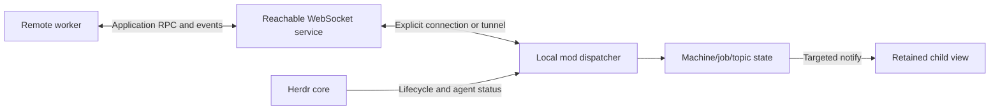

# Herdr SDK: remote workers, streams, and cell boundaries

Purpose: Identify existing SDK support and the application layer needed for segregated remote-worker data flows.
Reader: Herdr mod authors. Research date: 2026-11-14. Installed: herdr-app 0.1.15; hc 0.1.21.

**Conclusion:** Herdr provides remote lifecycle control and networking primitives, but no installed cell abstraction or direct mod-facing core event-stream client.

## Thinking

Scope: local native JavaScript mods; remote core routing; JSON-RPC and event transport; independent view/dataflow boundaries.
No exclusions were specified. Three independent research slices cover routing, streaming, and cells. The requested deep-researcher skill is unavailable.
Evidence priority: installed declarations and live protocol, pinned upstream source, protocol standards. Multiple Herdr files are one publisher.
Skills used: structured-research (method), creating-herdr-app-mods (SDK), muxer-subagents (delegation boundary), mq-query (Markdown), shared-context (storage), ISO 24495 parts 1/3/5 (clear technical report). Child-specific skill records are in their reports.
This section records scope and method, not private reasoning.

## Research

Herdr supplies building blocks, not a declared Cell runtime. The desktop mod stays local; a core on each machine runs its processes.
The closest built-in boundaries are machine-qualified addresses, filtered event subscriptions, framed transport channels, and retained child views.

### Use remote commands for lifecycle, not streaming payloads

`herdr.exec(command, args, {on, cwd, timeout})` runs a bounded command on a selected machine through core. It resolves collected stdout/stderr and exit code.
The installed contract limits output to 8 MiB and defaults to 30 seconds, capped at ten minutes. It is not an interactive subprocess handle.
`herdr.hc(args)` runs core CLI operations. `herdr.terminals()` exposes live terminal records for panels.
Keep the machine address (`machine/t7`) rather than a bare terminal ID when routing remote actions.
See [installed execution API](file:///home/zenobius/.config/herdr-app/herdr.d.ts#L4-L26) and [pinned execution API](https://github.com/herdrdev/herdr-app/blob/b67715e8985e6097f83f8120fc9b9e52e6596f50/defaults/herdr.d.ts#L4-L26).

### Use persistent transport for bidirectional communication

The installed runtime exposes `net.connect(host, port)` with async byte reads, writes, and close, and `WebSocket.connect(url)` from the `websocket` module.
These are local client connections: they do not inherit a space's SSH route or `on` option. A remote service needs a reachable endpoint or an explicitly supplied bridge/tunnel.
`fetch()` provides buffered `text()`/`json()`, not a response-body stream. `process.run()` returns collected output, not a persistent stdin/stdout handle.
See [installed transport declarations](file:///home/zenobius/.config/herdr-app/gpui-kit.d.ts#L22124-L22202).

Core separately exposes JSON-RPC 2.0 through its Unix socket/Windows named pipe or `hc connect` stdin/stdout. `ssh host hc connect` reaches a remote core.
Plain mode uses JSON lines; after `events.subscribe`, that plain connection carries notifications only. Use a second connection for calls or negotiate framed mode.
Framed mode carries RPC on channel 0, event subscriptions on their allocated channel, and terminal attachments on separate channels.
A terminal stream starts with 256 KiB credit; a stalled stream does not block control RPC or other streams. Beyond 4 MiB backlog it gets a repaint, not lossless output replay.
This is terminal-view flow control, not a durable application event bus. Terminal attach includes screen/terminal control sequences and should not be treated as clean application JSON-RPC stdio.
See [pinned wire protocol](https://github.com/herdrdev/herdr-core/blob/c84d6e76156a6c2aac1da20efbe800f10acfe897/schema/README.md#L20-L132).

No installed high-level `herdr.connectCore()` or typed streaming core client was found. JavaScript `net` only declares TCP host/port, not Unix-socket/named-pipe access.
[INFERENCE] A mod needing raw core subscriptions therefore needs a bridge/client integration; repeatedly calling `herdr.hc(["events"])` does not expose a stream.
Custom worker methods belong to your service protocol; core's JSON-RPC API does not automatically proxy arbitrary worker methods.

### Model cells with retained views and bounded state

No declared reactive `Cell`, signal graph, worker thread, or per-cell scheduling API was found in the installed SDK.
A retained child created with `cx.new(ViewClass, props)` can be updated using `entity.set_props(props)` or invalidated with `cx.notify(entity)`.
Those APIs target that child's description. They do not promise zero window repaint, CPU isolation, or security isolation.
`cx.spawn` runs asynchronous work with an AsyncContext; `cx.sleep`/timers use the foreground executor. Async is not proof of off-thread parsing. The [upstream state guide](https://gpui-kit.com/shell/state#asynchronous-work) explicitly says script-visible work stays on the main thread.
`herdr.setShared(key, value)` persists a shared value and re-renders every mod: it is a poor hot-event path.
See [retained view API](file:///home/zenobius/.config/herdr-app/gpui-kit.d.ts#L287-L411), [entity lifecycle](file:///home/zenobius/.config/herdr-app/gpui-kit.d.ts#L535-L585), and [shared-state API](file:///home/zenobius/.config/herdr-app/herdr.d.ts#L396-L400).

[INFERENCE] Treat a cell as an application-owned `(machine, worker/job, topic)` record containing its connection state, bounded buffer/latest snapshot, sequence, pending RPC requests, task handles, and retained view.
Route messages by that key. Give each view only the state it needs. Coalesce high-rate progress updates and retain full results remotely rather than copying every payload into shared UI state.
A bounded buffer is appropriate for replaceable progress; lossless business events require remote retention, acknowledgement, and replay in your own service contract.
Keep heavy transformation beside the remote data source and send compact results to the desktop.

Mods are trusted code with user-level program/network access. A cell is not an authorization boundary. See [app trust model](https://github.com/herdrdev/herdr-app/blob/b67715e8985e6097f83f8120fc9b9e52e6596f50/docs/security.md#L1-L28).

### Handle lifecycle and version differences explicitly

Own long-lived read tasks and sockets explicitly. `Task.cancel()` leaves the adopted promise pending; do not assume cancelling it closes a socket.
View `close(cx)` is root-only and bounded. Hiding a copy or switching tabs does not close it. Do not kill a remote worker merely because its local panel closes.
Core event sequences restart with the core. Reconnect with a fresh snapshot; handle `missed` snapshots and replace records received again after remote reconnect.
After terminal loss, attach streams end; reattach only after the replacement shell's `restarted` event. A replacement shell is not resumption of the original task.
See [installed lifecycle](file:///home/zenobius/.config/herdr-app/gpui-kit.d.ts#L550-L558) and [core events](https://github.com/herdrdev/herdr-core/blob/c84d6e76156a6c2aac1da20efbe800f10acfe897/schema/README.md#L115-L178).
Upstream documentation describes `events.subscribe.docs`; installed hc 0.1.21 schema exposes only `terminal`, `children_of`, and `labels`. Do not copy that newer filter into installed-version code without checking `hc schema`.

## Verification

Confidence labels below measure independent publisher count as requested, not whether an exact installed declaration was observed.
Product-specific claims remain LOW under that rule even when declarations and live observations agree. No three-independent-publisher corroboration was found for private SDK internals.

| Claim | Evidence and publisher | Source type | Access date | Confidence | Contradictions/limits |
|---|---|---|---|---|---|
| Local mods, remote core processes, remote exec | [SDK](https://github.com/herdrdev/herdr-app/blob/b67715e8985e6097f83f8120fc9b9e52e6596f50/defaults/herdr.d.ts#L4-L26), [trust model](https://github.com/herdrdev/herdr-app/blob/b67715e8985e6097f83f8120fc9b9e52e6596f50/docs/security.md#L1-L28); Herdr | Official declarations/docs; installed versions observed | 2026-11-14 | LOW, one publisher | No remote configured; remote runtime untested |
| Sockets permit persistent I/O; exec/fetch helpers are buffered | [Installed types](file:///home/zenobius/.config/herdr-app/gpui-kit.d.ts#L22124-L22202); Herdr/gpui-kit bundled declarations | Official installed API | 2026-11-14 | LOW, one product distribution | Generic capability-gating comments do not imply per-request Herdr permission prompts |
| Core uses multiplexed channels and per-stream flow control | [Wire protocol](https://github.com/herdrdev/herdr-core/blob/c84d6e76156a6c2aac1da20efbe800f10acfe897/schema/README.md#L20-L132); Herdr | Official docs plus local read-only runtime | 2026-11-14 | LOW, one publisher | Framed RPC/subscription exercised; terminal credit behavior not runtime-tested |
| Retained child targeting, no declared Cell API, broad shared invalidation | [Context](file:///home/zenobius/.config/herdr-app/gpui-kit.d.ts#L287-L411), [shared](file:///home/zenobius/.config/herdr-app/herdr.d.ts#L396-L400); installed declarations | Official installed API | 2026-11-14 | LOW | Absence scoped to inspected installed declarations, not all future versions |
| JSON-RPC is transport-independent and IDs correlate responses | [JSON-RPC specification](https://www.jsonrpc.org/specification#request_object); JSON-RPC Working Group | Protocol specification | 2026-11-14 | LOW, one standards publisher | Does not itself supply framing, replay, or cell routing |
| WebSocket supports two-way messages | [RFC 6455 section 1.2](https://www.rfc-editor.org/rfc/rfc6455.html#section-1.2); IETF, I. Fette/A. Melnikov | Standards-track RFC | 2026-11-14 | LOW, one standards publisher | Does not verify this product's queue limits |
| OpenRPC describes JSON-RPC APIs and rpc.discover | [OpenRPC specification](https://spec.open-rpc.org/#service-discovery-method); OpenRPC project | Protocol description standard | 2026-11-14 | LOW, one standards publisher | Schema version, not upstream prose, governs installed params |

Live smoke observations:

- **Versions:** `herdr-app --version` returned 0.1.15; `hc --version` returned 0.1.21.
- **Remote availability:** `hc machine ls --json` returned `{"machines":[]}`.
- **Plain RPC:** `terminal.list` and then `events.subscribe` succeeded through `hc connect`; subscription returned snapshot and sequence.
- **Framed RPC:** `hello` with framed true succeeded; concurrently sent `events.subscribe` and `server.status` both replied on channel 0. Subscription allocated channel 1.
- **Limits:** No remote execution, socket mod, terminal attach, throughput, latency, loss/reconnect, visual rendering, or isolation benchmark was exercised. No app/mod configuration changed.

[VendorBias] Product behavior relies on vendor source and installed distribution. [VersionBias] Upstream master can include unreleased additions. [SelectionBias] No independent Herdr SDK evaluation located; protocol standards only validate protocol concepts.

## Insights

[INFERENCE] Use two distinct planes: core for process lifecycle/status, and a worker service connection for structured application RPC/events.
Use retained child views for local update boundaries. Only introduce separate connections where you need independent transport queues; a logical key alone cannot remove transport or CPU contention.
[INFERENCE] Proposed application dataflow (not a built-in SDK feature):

The dispatcher routes service messages into bounded per-job state and updates only the owning child view; core remains the lifecycle/status source.

Core already solves machine routing, terminal channels, and terminal flow control. It does not supply your application's cell schema, dispatcher, durable event log, or worker-service tunnel API.

## Summary

Herdr facilitates this design through remote execution, live core state, raw sockets, multiplexed core channels, async tasks, and retained child views.
It does not expose a complete cell-based remote-processing SDK. Define the cells and worker protocol in the mod/service layer; keep high-volume work remote and UI updates narrowly targeted.

Related reports: [remote routing](research-c92f-herdr-sdk-remote-routing.md), [streaming](research-731a-herdr-sdk-streaming.md), [cells](research-4b7d-herdr-sdk-cells.md).

