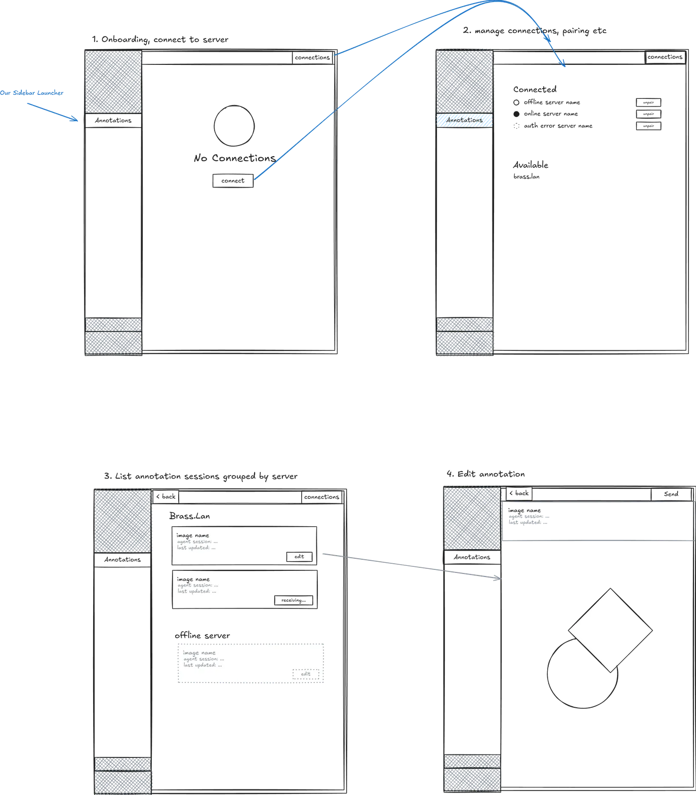

## Problem Statement

The image annotation extension opens a desktop browser editor. Users cannot choose a reMarkable Paper Pro, draw with its pen, and return the result to the originating Pi/OMP request. Manual image transfers interrupt the annotation workflow. Multiple conversations also need reliable result routing.

Users need a tablet client that they install once and pair with a local annotation server. Normal use must not require SSH, a USB connection, or manual file transfers.

## Solution

Add Pi Ink Bridge to the existing image annotation workflow. Run one persistent annotation service for the desktop user. Provide a Paper Pro client with a sidebar entry, an annotation inbox, and a full-screen drawing surface. Keep the browser editor as a supported target.

Run `/annotate add-device` to start the service and print a LAN-accessible setup URL. Open that page on the desktop. Follow its SSH installation instructions for the tablet. The installer downloads and verifies the client archive, installs the client, and reports any required restart.

Open the tablet widget to discover local annotation servers through multicast DNS (mDNS). Select a server and complete explicit pairing. After pairing, select the online tablet from the extension. The service sends the annotation job to that tablet.

On the tablet, select an image from the inbox and draw annotations. Save a draft without completing the request, or send the completed annotation. The service stores the result and returns its PNG image to the originating Pi/OMP request.

## User Stories

1. As a desktop user, I want to run `/annotate add-device`, so that I can add a tablet from Pi/OMP.
2. As a desktop user, I want the command to start an available service only once, so that concurrent extension instances share it safely.
3. As a desktop user, I want a clear service readiness error, so that I do not open a setup page for a failed service.
4. As a desktop user, I want a LAN-accessible setup URL, so that the tablet can download its client from my desktop.
5. As a desktop user, I want the setup page to show Paper Pro prerequisites, so that I understand Developer Mode and firmware requirements before installation.
6. As a tablet owner, I want a generated installation command, so that I can install the correct client through one SSH session.
7. As a tablet owner, I want verified installation downloads, so that a LAN attacker cannot replace code that runs on my tablet.
8. As a tablet owner, I want installation to reject unsupported hardware and firmware before changes, so that it does not damage my existing setup.
9. As a tablet owner, I want installation to preserve unrelated tablet files, so that existing applications remain available.
10. As a tablet owner, I want clear restart instructions, so that I know how to activate the installed sidebar entry.
11. As a tablet user, I want a Pi Annotations sidebar entry, so that I can open the client without a terminal.
12. As a tablet user, I want to discover nearby annotation servers, so that I do not need to enter their addresses during normal setup.
13. As a tablet user, I want to add a server by address, so that pairing works when the network blocks multicast.
14. As a tablet user, I want a recognizable server name and stable identity, so that I select the intended desktop.
15. As a desktop user, I want to approve pairing and compare a code, so that discovery alone cannot grant access to annotations.
16. As a desktop user, I want pairing requests to expire, so that an old request cannot grant later access.
17. As a tablet user, I want pairing to persist across restarts, so that I do not approve the same trusted connection each time.
18. As a desktop user, I want to revoke a tablet, so that a lost or retired device cannot access new jobs.
19. As a desktop user, I want to select a paired tablet or the browser editor, so that I can choose the appropriate drawing surface.
20. As a desktop user, I want to distinguish online tablets from paired tablets, so that pairing does not imply availability.
21. As a desktop user, I want an offline error with recovery instructions, so that I know to turn on the tablet and open its widget.
22. As a desktop user, I want acknowledgement that the tablet stored my job, so that delivery status is reliable.
23. As a tablet user, I want a list or grid of assigned images, so that I can select the job to annotate.
24. As a tablet user, I want thumbnails, request text, project context, and job status, so that I can distinguish similar images.
25. As a tablet user, I want a locked source image and pen annotation, so that I can mark the image without moving its background.
26. As a tablet user, I want erasing and undo, so that I can correct my annotations.
27. As a tablet user, I want pan and zoom, so that I can annotate image details.
28. As a tablet user, I want saved strokes to remain aligned with the source, so that display scaling does not change their meaning.
29. As a tablet user, I want to save an editable draft without sending it, so that unfinished work does not complete the agent request.
30. As a tablet user, I want drafts to survive a client restart, so that closing the widget does not discard my work.
31. As a tablet user, I want to continue an already downloaded job while disconnected, so that a temporary network failure does not erase my work.
32. As a tablet user, I want Send to return the completed annotation, so that Pi/OMP can use the marked image.
33. As a tablet user, I want a local copy until the server acknowledges durable receipt, so that a connection failure does not lose my result.
34. As a desktop user, I want duplicate submissions to return one result, so that reconnecting does not add duplicate agent messages.
35. As a desktop user, I want each image to return to its originating request, so that another active conversation cannot receive it.
36. As a desktop user, I want multiple extension instances to remain isolated, so that simultaneous jobs do not overwrite each other.
37. As a desktop user, I want cancellation to remain terminal, so that a late tablet submission cannot revive a cancelled request.
38. As a desktop user, I want stored results to survive a service restart, so that an accepted annotation does not disappear.
39. As a desktop user, I want matching requests to recover stored results after reconnecting, so that a disconnected extension does not cause wrong-session delivery.
40. As a tablet user, I want clear status when the originating request is unavailable, so that I do not mistake a local save for agent delivery.
41. As a desktop user, I want the existing browser workflow to remain available, so that tablet setup is optional.
42. As a desktop user, I want credentials and images protected on the LAN, so that another network user cannot read or submit annotations.

## Implementation Decisions

### Components and lifecycle

- **Extension integration:** Add `/annotate add-device` and target selection. Preserve existing image commands, tool completion, cancellation, source selection, and browser behaviour. Keep the existing completed PNG result contract.
- **Shared annotation service:** Use one service per desktop user, not one service per project or extension instance. It owns device registration, pairing, presence, job storage, and result routing. It must continue after an individual extension process exits.
- **Service management:** Use mise to install pinned desktop dependencies and bootstrap the service. Use Pitchfork to supervise it and check readiness. Do not couple service lifetime to directory entry or exit. Concurrent startup requests must converge on one compatible service.
- **Version checks:** Extension and tablet connections must negotiate a supported protocol version. Report an incompatible version without discarding existing jobs or device credentials.
- **Tablet client:** Use an AppLoad application for the inbox and drawing surface. Use a thin XOVI integration for the sidebar entry. Keep networking and drawing logic outside the firmware-sensitive sidebar patch.
- **Desktop management:** Provide a loopback management surface for pairing approval and revocation. The LAN setup page may provide instructions and installation downloads. It must not provide unauthenticated administrative actions. Protect browser mutations against cross-site requests and reject unexpected hosts and origins.

### Installation and trust

- **Explicit prerequisite:** Explain that Paper Pro Developer Mode is required. Explain its factory reset and security effects before installation. The installer must not enable Developer Mode automatically.
- **One-time SSH:** Use SSH only for installation and repair. Normal discovery, pairing, annotation, and return use the LAN client connection.
- **Verified bootstrap:** Generate installation instructions that download the installer and client ZIP archive from the LAN service. Verify both before execution or extraction. Supply expected digests through the trusted desktop extension output or trusted loopback management surface. A checksum fetched beside a file over plain HTTP is not a trust anchor.
- **Server trust:** Provision the intended server identity and certificate fingerprint through the verified installation flow. Use encrypted, authenticated connections for pairing, credentials, source images, and results. Do not disable certificate verification to accept a self-signed server certificate. A manually added server needs an explicit trusted fingerprint check.
- **Safe installation:** Check the tablet model, firmware, available dependencies, and required permissions before changes. Install client data under the home partition where supported. Preserve unrelated files. Repeating installation must not duplicate sidebar entries or erase drafts and pairing data. Report whether an application restart or device reboot is required.
- **Compatibility boundary:** Establish and document a tested Paper Pro firmware range. Do not assume XOVI or AppLoad compatibility with every firmware version. Reject unsupported versions with an actionable explanation.

### Discovery and pairing

- **mDNS advertisement:** Advertise the proposed service type `_pi-annotate._tcp`. Publish server ID, display name, port, supported protocol version, and pairing availability. Do not publish credentials, job details, conversation content, or image names.
- **Discovery limits:** Provide manual server-address entry when multicast fails. Explain that a shared Wi-Fi name does not guarantee reachability when client isolation or firewall rules block traffic. Never modify firewall rules silently.
- **Explicit approval:** Pair only during a bounded onboarding window. Show a matching code on the tablet and local management page. Require local desktop approval before issuing a device credential. Limit failed pairing attempts. Discovery and installer possession do not grant image access.
- **Device identity:** Give each paired tablet a stable device ID and a revocable credential. Store credentials outside logs and URLs. Restrict local credential storage permissions. Revocation closes active connections and blocks subsequent authenticated requests.
- **Stable server identity:** Keep server identity independent of hostname and IP address. Rediscovery can update an address only when the saved server identity and certificate trust still match.

### Transport and job contract

- **Outbound connection:** The tablet initiates an authenticated WebSocket connection. Use it for readiness, heartbeat, job availability, acknowledgement, cancellation, and completion notifications. Do not require inbound tablet ports. Do not implement a parallel SSE transport.
- **Image transfer:** Use authenticated HTTPS requests for thumbnails, source images, draft synchronization, and completed uploads. Notifications reference stable job IDs rather than carrying image payloads. A tablet can access only jobs assigned to its device ID.
- **Request ownership:** Record the job ID, originating extension instance, originating Pi/OMP session and request identity, selected device ID, source image identity, request text, project display context, and job state. Do not expose arbitrary desktop filesystem paths to the tablet.
- **Online definition:** A device is online only when its authenticated connection is current and the client reports readiness. A paired device without a ready connection is offline. An online device may have several inbox jobs.
- **Offline behaviour:** Reject a new dispatch to an offline device. Tell the user to turn on the device and open Pi Annotations. Do not silently queue a new offline dispatch or switch to another device.
- **Dispatch acknowledgement:** Mark a job as delivered only after the tablet acknowledges local storage. If the connection fails before acknowledgement, report delivery as unconfirmed. Reconcile by stable job ID before redispatch, so an uncertain acknowledgement cannot duplicate the inbox item.
- **Durable state:** Keep jobs, drafts received by the service, device records, and accepted results in persistent service storage. Keep source pixels and editable strokes separate. Use source-image coordinates for strokes and preserve source dimensions during composition.
- **State transitions:** Distinguish pending delivery, delivered, editing, draft saved, result accepted, result delivered, and cancelled. A draft save never resolves the extension request. Cancelled jobs never return an image to an agent. Late results must not change a cancelled job to completed.
- **Save and Send:** Save persists editable strokes locally before reporting success. Synchronize when connected without completing the request. Send uploads the completed annotation. Report server acceptance only after a durable write. Retain a local result until acknowledgement.
- **Result contract:** Produce a flattened PNG with the source image and annotation strokes aligned at the source dimensions. Retain editable strokes separately. Whether composition runs on the tablet or service is an implementation detail if these output and durability requirements hold.
- **Duplicate protection:** Give a completed submission a stable identity. Repeated submission of the same result returns its stored acknowledgement. A repeated notification must not produce a second image delivery to the originating request.
- **Extension delivery:** Notify the originating extension only after storing the accepted result. Recover by stable request identity after reconnection. Never send to whichever conversation is active. If the request cannot be recovered, retain the accepted result and report that agent delivery is pending or unavailable. Do not claim delivery without acknowledgement.
- **Cancellation and isolation:** Propagate cancellation to the tablet when connected. Enforce cancellation at the service even when the tablet is disconnected. Isolate jobs from other extension instances, conversations, tablets, and desktop users.
- **Bounded input:** Validate source images and completed exports. Retain the existing source and export size limits unless a documented consumer requirement changes them. Reject malformed or oversized data without corrupting saved work.

### Tablet interaction

- **Annotation inbox:** Show assigned jobs in a list or grid. Include a thumbnail, request text, project display name, and status. Keep an empty state, connection state, and clear error messages.
- **Drawing surface:** Provide a locked source image, pen, eraser, undo, pan, and zoom. Preserve stroke alignment when the display scale or orientation changes. Do not port the desktop React/Excalidraw interface to the tablet.
- **Distinct actions:** Label draft saving separately from sending. Show local-save status, server acceptance, and agent delivery as distinct outcomes. Keep downloaded work available through a temporary disconnect.

## Testing Decisions

- **Approved seam:** The user selected one main integration seam: extension submission through the real annotation service and tablet protocol operations to the returned image. Do not create a separate ink geometry unit-test suite for this initiative.
- **External behaviour:** Test observable permissions, state transitions, persistence, errors, image content, and result routing. Do not test internal forwarding, copied data, source text, incidental defaults, or exact error wording.
- **Existing prior art:** The extension has Bun tests that start a real annotation HTTP server, send real HTTP requests, and inspect returned image bytes. Its editing-session tests exercise command completion, cancellation, and abort. Reuse those patterns rather than adding a second test framework.
- **Integration harness:** Start the real service with isolated temporary storage. Use the extension entry point and a tablet protocol client over actual HTTPS and WebSocket connections. The protocol client is a test peer, not proof of native tablet drawing quality. Keep only process-launch and agent-host boundaries controlled where required.
- **Pairing cases:** Prove that an unpaired client cannot read an image. Prove that pending, expired, denied, revoked, wrong-server, and incompatible-version connections do not gain access. Prove that approved pairing works after reconnecting.
- **Dispatch cases:** Prove successful online dispatch and durable tablet acknowledgement. Prove offline rejection, disconnect-before-acknowledgement handling, and reconciliation without duplicate inbox jobs.
- **Save and result cases:** Prove that Save does not complete the request. Prove that Send returns the expected annotated pixels and source dimensions. Use a known source and known strokes to expose alignment errors through the main integration seam.
- **Recovery cases:** Restart the service after result acceptance but before extension delivery. Reconnect the matching request and prove one delivered image. Repeat an upload and notification to prove duplicate protection. Keep independent requests isolated.
- **Cancellation cases:** Cancel before editing and during a disconnect. Submit a late result and prove that the request remains cancelled. Switch the active conversation and prove that another conversation never receives the result.
- **Browser regression:** Exercise the existing browser target through its current integration path. Preserve new drawings, source annotation, explicit completion, cancellation, abort, and the absence of an arbitrary editing deadline.
- **Hardware acceptance:** Install on a supported Paper Pro. Observe sidebar launch, real mDNS discovery, pairing approval, online dispatch, list/grid selection, pen strokes, erasing, undo, pan, zoom, draft recovery, and Send. Confirm aligned PNG receipt in the originating Pi/OMP session.
- **Installation acceptance:** Repeat installation without losing pairing or drafts. Verify unsupported firmware rejection before changes. Alter a download and verify rejection before execution. Report any required restart and observe the client after that restart.
- **Network acceptance:** Test the supported desktop firewall configuration and tablet sleep/wake cycle on a real LAN. Verify manual address entry when multicast is unavailable. Do not treat a protocol simulation as proof of mDNS or tablet readiness.
- **Pen quality gate:** Prove one real image-to-pen-to-PNG round trip before committing to the complete tablet UI. Confirm usable pen latency and palm handling on the supported device. AppLoad support alone does not prove native-quality ink.

## Out of Scope

- **Remote access:** Internet exposure, cloud relays, router port forwarding, and cross-network discovery are excluded.
- **Normal-use SSH:** SSH tunnels and USB networking as the annotation transport are excluded. SSH remains an installation and repair tool.
- **Other tablets:** reMarkable 1, reMarkable 2, Paper Pro Move, and unrelated tablet platforms are excluded from the initial compatibility contract.
- **Stock document changes:** Replacing Xochitl, modifying its notebook file format, and using cloud notebook synchronization as the annotation transport are excluded.
- **Automatic system changes:** Enabling Developer Mode, silently opening firewall ports, and upgrading tablet firmware automatically are excluded.
- **Collaborative editing:** Simultaneous multi-user drawing on one job and live stroke streaming to the agent are excluded.
- **Image generation:** AI image generation, handwriting recognition, and interpretation of annotations are excluded.
- **Extra transports:** SSE, direct inbound tablet servers, and a second normal-use transport are excluded.
- **Offline dispatch:** Queueing newly submitted jobs for an offline tablet is excluded. Local drafts and already downloaded jobs remain recoverable.
- **Tracker execution:** Child implementation tickets, implementation claims, and migration of unrelated legacy records are not part of this specification publication.

## Further Notes

### Acceptance boundary

The feature is complete only when a user can add a device, install the client, discover and pair a server, dispatch to an online tablet, annotate, save, and send. The originating Pi/OMP request must receive the aligned image. Offline errors, cancellation, reconnection, and duplicate submission must preserve the stated invariants. Compilation or a protocol-only demonstration does not satisfy tablet acceptance.

### Known facts and remaining proof

The current extension provides a browser editor and returns PNG bytes. It does not yet provide device management, a shared persistent service, LAN pairing, or a native tablet client. No product implementation or hardware verification occurred during specification preparation.

Paper Pro requires Developer Mode for custom software. Enabling it resets the device and weakens secure-boot protections. AppLoad provides QML frontends and optional native backends. These facts do not establish compatibility or acceptable pen performance on a particular firmware version. Implementation must record the tested firmware and dependency versions.

The repository has no existing domain glossary or relevant recorded ADR for this feature. Use service, server, tablet client, device, job, draft, result acceptance, and agent delivery consistently. A server is the network identity of the desktop annotation service.

### References

- [Paper Pro Developer Mode](https://developer.remarkable.com/documentation/developer-mode)
- [reMarkable software stack](https://developer.remarkable.com/documentation/software-stack)
- [AppLoad application model](https://github.com/asivery/rm-appload)
- [XOVI extension framework](https://github.com/asivery/xovi)
- [Pitchfork service supervision](https://github.com/jdx/pitchfork)

### Specification decisions

The user approved one main integration seam, with separate real-device acceptance. Readiness metadata is omitted because the tracker configuration defines readiness for tickets but provides no initiative readiness mapping. This initiative has no executable children yet.

### Proposed tablet client UI

The user supplied this proposed tablet client UI. It shows the disconnected state, server connections, the server annotation inbox, and the annotation editor. This is a design reference, not implementation evidence.

## Tickets

No child tickets have been created.

## Comments

The specification records the conversation workflow and the approved testing seam.

