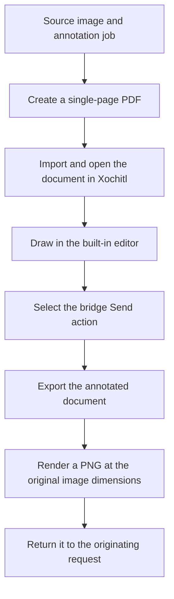

# Pi Ink Bridge: latency reduction research

Compare annotation surfaces and select the next hardware prototype.

Date: 2026-11-02. Primary readers: the initiative maintainer and the next prototype implementer.

Status: Research proposal. The user requested storage and association with the initiative, not adoption of a new design.

Read the [approved initiative specification](index.md) for the current requirements. Read the [pen prototype ticket](../../tickets/pi-ink-bridge-01-pen-prototype.md) for the executed experiment and its failed quality gate.

## Overview

Test the built-in document editor before building another drawing engine. Let the bridge manage annotation jobs while Xochitl, the tablet's main application, handles drawing.

[INFERENCE] This offers the best chance of stock drawing performance because it removes our custom stroke-rendering path. It does not establish a usable or supported automation interface.

Local import, document opening, and annotated export remain unverified. If these operations require unsafe document-store changes, stop this approach. Then benchmark a small native renderer.

The existing prototype failed the owner's latency check. Its controlled shutdown also produced SIGSEGV. Saving this research does not clear either blocker or authorize production work.

### Contents

- **Overview:** [Overview](#overview).
- **Existing evidence:** [Keep the failed prototype as the baseline](#keep-the-failed-prototype-as-the-baseline).
- **Options:** [Compare the drawing options](#compare-the-drawing-options).
- **Built-in editor:** [Use Xochitl for drawing](#use-xochitl-for-drawing).
- **Custom drawing:** [Use a native renderer if the editor adapter fails](#use-a-native-renderer-if-the-editor-adapter-fails).
- **Next experiment:** [Prove one complete document round trip](#prove-one-complete-document-round-trip).
- **Scope:** [Keep the current scope until a decision is approved](#keep-the-current-scope-until-a-decision-is-approved).
- **References:** [Sources and confidence limits](#sources-and-confidence-limits).

## Keep the failed prototype as the baseline

The native pen backend returned real annotated PNG images at the source dimensions. The owner confirmed alignment with the client Scale and Rotate controls. The owner reported no palm problems, but reported unusable pen latency.

The experiment exercised firmware 3.28.0.172, Qt 6.10.3, AppLoad 0.5.1, and XOVI 0.3.3. It did not establish a supported firmware range.

The timing bottleneck was not profiled. Input counters and paint counters are not calibrated pen-to-display latency measurements. The failure does not prove that the pen device, local network, or every QML application is slow.

The [hardware findings](../../../workflows/pi-ink-bridge-01-pen-prototype/artifacts/evidence/pen-round-trip-002/findings.json) distinguish observed results from unverified claims. The [restoration record](../../../workflows/pi-ink-bridge-01-pen-prototype/artifacts/evidence/pen-round-trip-002/restoration.json) records the shutdown failure and original-runtime recovery.

The temporary source is preserved in local branch `prototype/pi-ink-bridge-01-pen-prototype`, commit `d17c0898f2219b3097f6a4e37bafd430f4c53b89`. It is not production code.

## Compare the drawing options

| Approach | Main advantage | Main risk | Proposed role |
| --- | --- | --- | --- |
| Built-in editor with image-backed PDF | Reuses the stock drawing interface and document editing tools. | Local import, opening, and annotated export may require private interfaces. | First feasibility test. |
| Native custom renderer | Keeps direct control of jobs, source coordinates, Save, and Send. | Fast drawing and safe lifecycle handling still need hardware proof. | Fallback if the editor adapter is unsafe or incomplete. |
| Improve the current Canvas prototype | Tests whether avoidable message and repaint overhead explains the delay. | It retains the current rendering and AppLoad lifecycle risks. | Short diagnostic experiment, not the preferred production design. |

## Use Xochitl for drawing

Prefer a single-page Portable Document Format (PDF) file containing the source image. Do not generate private reMarkable notebook files. Open the imported document in the normal editor rather than embedding private editor components inside AppLoad.

The following flow is proposed. Local automation has not been verified.

The bridge retains the job ID, document UUID, source dimensions, and original page bounds. UUID means universally unique identifier. Keep this association separate from the currently open document or conversation.

Draft saving must remain separate from Send. Closing or saving a stock document must not complete the agent request. A separate bridge action must obtain the completed annotation and submit it through the existing request ownership rules.

### Respect document and export boundaries

- **Export the annotation:** Copying the stored original PDF does not obtain the completed annotation. Xochitl stores the original PDF separately from page handwriting. Use a real annotated export or a verified rendering path.
- **Avoid private-file writes:** reMarkable warns that Xochitl should not run while stored documents are accessed or changed. Do not implement normal operation by editing its private document files while it runs.
- **Verify local automation:** No supported local application programming interface (API) for the required import, opening, and annotated export operations has been verified. Do not treat these operations as solved.
- **Preserve image bounds:** Track the original page bounds through export. Crop and render the result at the original pixel dimensions. Check margins, page rotation, and marks near the image edges.
- **Keep transfer local:** Normal operation must still use the local area network (LAN). Cloud synchronization, SSH transfers, and USB transfers are not the normal annotation transport.
- **Check cloud participation:** Determine whether newly imported job documents enter the user's existing cloud synchronization. This is an open privacy question. Do not silently change account settings.
- **Pin compatibility:** Xochitl is proprietary, and reMarkable gives no compatibility guarantee between versions. Any private integration needs an explicit tested firmware boundary.

These document facts and compatibility warnings come from the [official Xochitl documentation](https://developer.remarkable.com/documentation/xochitl).

## Use a native renderer if the editor adapter fails

Keep the complete pen-to-display path in native code. Keep job management, transfer, and export outside that path.

- **Remove per-point UI messages:** Avoid sending every pen sample through JavaScript Object Notation (JSON) and QML before drawing it. Preserve every stroke sample even when display updates are combined.
- **Draw incrementally:** Draw new stroke segments and update their affected screen regions. Do not redraw the background and complete stroke history for every update.
- **Separate display and history:** Keep editable stroke history independent of the display buffer. Compose the flattened result when the user selects Send.
- **Keep transfer separate:** Saving, source-image transfer, and result upload must not block live drawing.
- **Measure before choosing:** Record input arrival, renderer work, queue growth, and visible ink delay. Rendering callbacks alone do not measure physical display completion.

Qt warns against frequent updates to large `Canvas.Image` surfaces. Its documentation recommends considering C++ drawing with `QQuickPaintedItem` and `QPainter`. This is a candidate implementation, not proof of stock pen latency. See the [Qt Canvas performance guidance](https://doc.qt.io/qt-6/qml-qtquick-canvas.html).

AppLoad also supports external applications using QTFB, its shared-memory framebuffer interface. The client source exposes partial updates, refresh-mode controls, and full-refresh requests. This is another candidate for a small native drawing prototype. See the [AppLoad application model](https://github.com/asivery/rm-appload) and [QTFB client implementation](https://github.com/asivery/rm-appload/blob/master/backends/qtfb-clients/cpp/qtfb-client.cpp).

Neither candidate has passed this initiative's hardware quality gate. Check the APIs against the installed AppLoad and firmware versions before implementation.

The [official Qt Quick application guide](https://developer.remarkable.com/documentation/qt_epaper) describes the e-paper backend, but does not demonstrate marker handling. Its standalone example stops Xochitl. Do not treat that example as a complete daily-use annotation lifecycle.

## Prove one complete document round trip

1. Establish a drawing baseline in the stock editor on the same device and firmware.
2. Create one image-backed PDF with known page bounds and visible alignment marks.
3. Prove local import and document opening without changing private notebook files while Xochitl runs.
4. Draw with the real pen. Check latency, palm handling, erasing, undo, zoom, and source alignment.
5. Use an explicit Send action to obtain an annotated export. Verify that a draft save does not complete the request.
6. Render the exported annotation at the original PNG dimensions. Check edge marks and return it to the originating request.
7. Check cancellation, document ownership, and any cloud participation before expanding the experiment.
8. Compare pen-to-visible-ink delay with the stock baseline. Use physical observation or video as well as renderer timings. Record whether queues grow during long strokes.

Accept the editor adapter only if the local round trip is reliable and safe. If local export or document ownership remains unsafe, stop and test a native renderer instead.

Do not select an arbitrary millisecond target after seeing the result. Agree the quality threshold before the next hardware test. No new latency measurement or tablet experiment occurred while writing this research.

## Keep the current scope until a decision is approved

The proposed built-in editor adapter replaces the current custom drawing-surface decision. Approval to store this research is not approval to make that change.

Keep pairing, authenticated LAN transfer, request isolation, explicit Send, terminal cancellation, browser availability, and the PNG result contract. Do not introduce a cloud relay, normal-use SSH, or a second transport as a shortcut.

The next decision is whether to prototype the stock-editor adapter first. If approved, update the initiative before production work starts. Dependent production tickets remain blocked by the failed pen-quality gate.

## Sources and confidence limits

- **Executed experiment:** [Pen prototype ticket and review](../../tickets/pi-ink-bridge-01-pen-prototype.md), [hardware findings](../../../workflows/pi-ink-bridge-01-pen-prototype/artifacts/evidence/pen-round-trip-002/findings.json), and [restoration record](../../../workflows/pi-ink-bridge-01-pen-prototype/artifacts/evidence/pen-round-trip-002/restoration.json). These support the prototype observations only.
- **Document ownership:** [Official Xochitl documentation](https://developer.remarkable.com/documentation/xochitl). This supports the document layout, private-file access warning, cloud service description, and compatibility boundary. It does not establish the required local automation API.
- **Platform context:** [Official software stack documentation](https://developer.remarkable.com/documentation/software-stack). This identifies Xochitl as proprietary Qt software.
- **Official custom application example:** [Writing Qt Quick applications](https://developer.remarkable.com/documentation/qt_epaper). This supports the e-paper application setup, not low-latency marker handling.
- **Canvas cost:** [Qt Canvas documentation](https://doc.qt.io/qt-6/qml-qtquick-canvas.html). This supports the rendering guidance, not a measured diagnosis of this prototype.
- **External application support:** [AppLoad documentation](https://github.com/asivery/rm-appload). This supports the external-app and framebuffer options, not their latency on the tested device.
- **Partial framebuffer updates:** [QTFB client source](https://github.com/asivery/rm-appload/blob/master/backends/qtfb-clients/cpp/qtfb-client.cpp). This establishes available source-level operations. Check compatibility with the installed release.

The primary sources were inspected during the latency discussion. Some documentation follows current development versions. Recommendations remain proposals until the next device test provides evidence.
