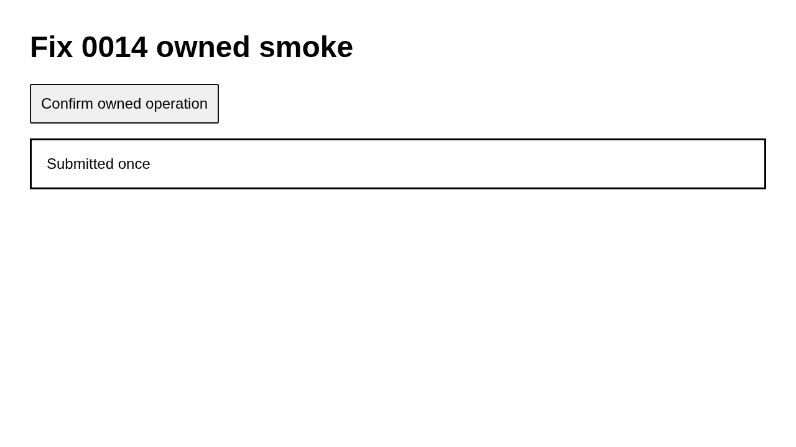

# Case approved

Allow the approved confirmation

## Step approved.1

Open the owned page

Expected: null

Observed: Page loaded.

Assertion: not-applicable

## Step approved.2

Confirm the owned operation

Expected: null

Observed: Pressed Space.

Assertion: not-applicable

## Step approved.3

Check the submitted state

Expected: {"text":"Submitted once","visible":null,"url":null}

Observed: Captured before expect.; Found text: Submitted once

Assertion: passed

Limits: Capture time and viewport are unknown when the driver did not record them.; Only executed expect evidence with assertionPassed=true can establish a passing assertion.

