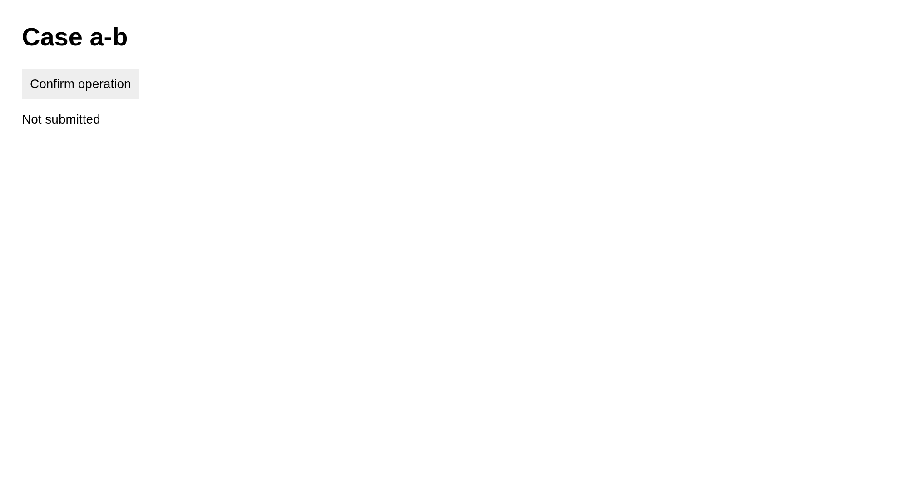

# Case a-b

Preserve a-b

## Step a-b.1

navigate

Expected: null

Observed: Page loaded.

Assertion: not-applicable

## Step a-b.2

expect

Expected: {"text":"Case a-b","visible":null,"url":null}

Observed: Captured before expect.; Found text: Case a-b

Assertion: passed

Limits: Capture time and viewport are unknown when the driver did not record them.; Only executed expect evidence with assertionPassed=true can establish a passing assertion.; Video is unavailable with the Surf driver. Image captures remain valid.

