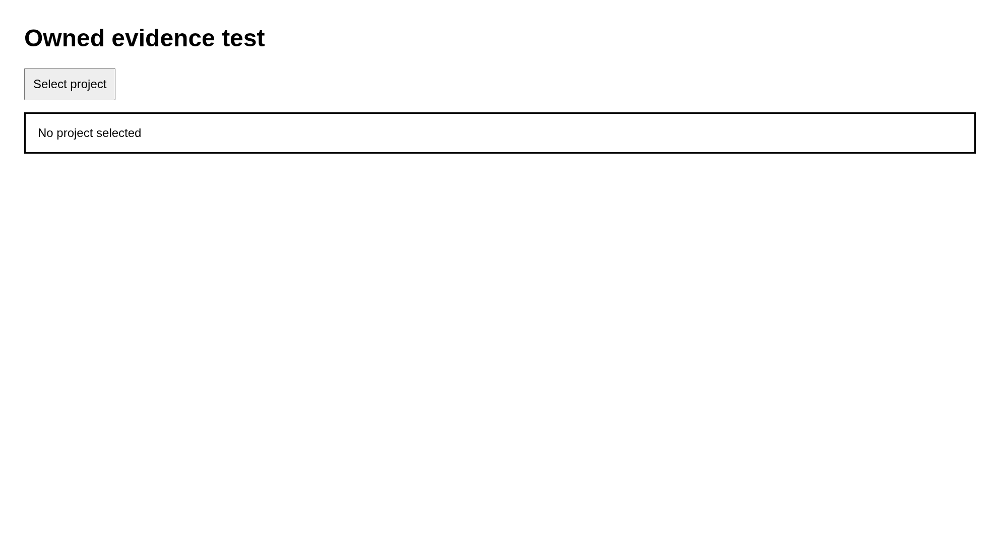

# Case failure

Reject an incorrect observation

## Step failure.1

Open the owned page

Expected: null

Observed: Page loaded.

Assertion: not-applicable

## Step failure.2

Check for missing text

Expected: {"text":"This text is absent","visible":null,"url":null}

Observed: Error: ASSERT FAIL failure.2: expected This text is absent, got No project selected
    at <anonymous>:2:261
    at tick (<anonymous>:2:345)

Assertion: failed

Limits: Capture time and viewport are unknown when the driver did not record them.; Only executed expect evidence with assertionPassed=true can establish a passing assertion.; Video is unavailable with the Surf driver. Image captures remain valid.

