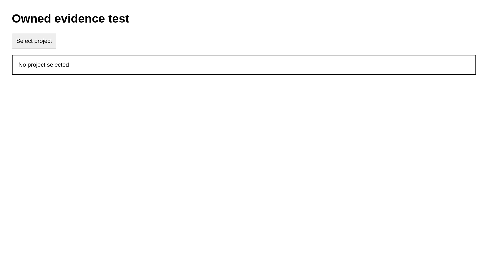
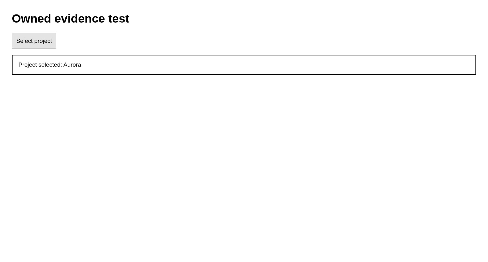

# Case pass

Select the named project

## Step pass.1

Open the owned page

Expected: null

Observed: Page loaded.

Assertion: not-applicable

## Step pass.2

Check the heading

Expected: {"text":"Owned evidence test","visible":null,"url":null}

Observed: Captured before expect.; Found text: Owned evidence test

Assertion: passed

## Step pass.3

Select Select project

Expected: null

Observed: Clicked.

Assertion: not-applicable

## Step pass.4

Check the selected project

Expected: {"text":"Project selected: Aurora","visible":null,"url":null}

Observed: Captured before expect.; Found text: Project selected: Aurora

Assertion: passed

Limits: Capture time and viewport are unknown when the driver did not record them.; Only executed expect evidence with assertionPassed=true can establish a passing assertion.; Video is unavailable with the Surf driver. Image captures remain valid.

