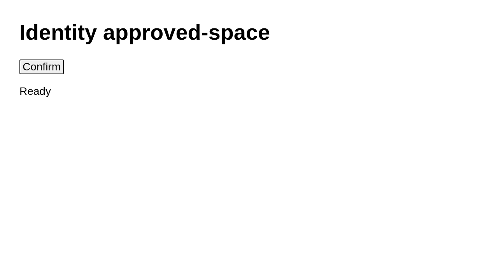

# Case approved-space

Observe identity approved-space

## Step approved-space.1

navigate

Expected: null

Observed: Page loaded.

Assertion: not-applicable

## Step approved-space.2

press

Expected: null

Observed: Pressed Space.

Assertion: not-applicable

## Step approved-space.3

expect

Expected: {"text":"Submitted once","visible":null,"url":null}

Observed: Captured before expect.; ASSERT FAIL approved-space.3: expected "Submitted once", got "Ready"

Assertion: failed

Limits: Capture time and viewport are unknown when the driver did not record them.; Only executed expect evidence with assertionPassed=true can establish a passing assertion.

