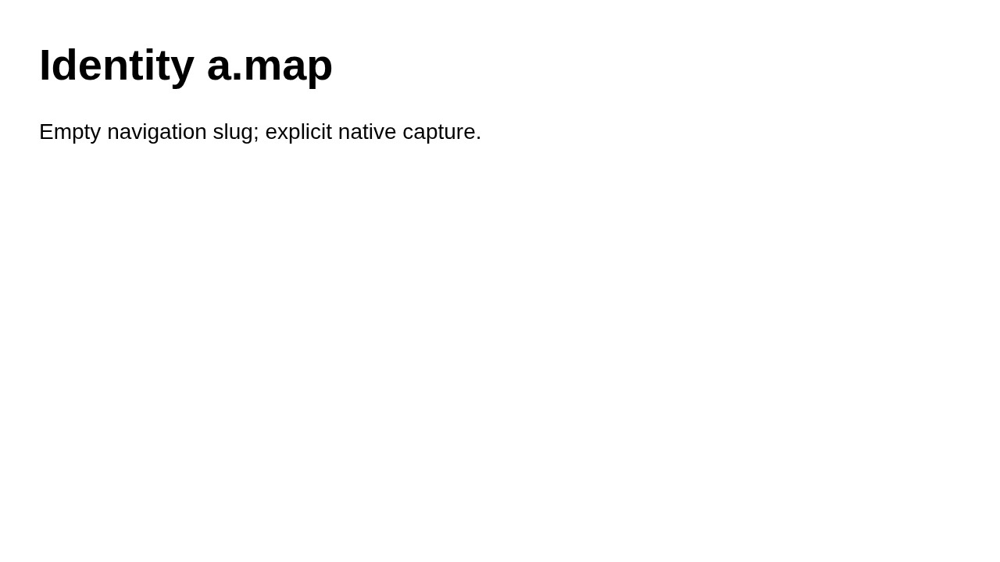

# Case a.map

Observe identity a.map

## Step a.map.1

Open the identity page without a screenshot

Expected: null

Observed: Page loaded.

Assertion: not-applicable

## Step a.map.2

Check the exact identity

Expected: {"text":"Identity a.map","visible":null,"url":null}

Observed: Found text: Identity a.map

Assertion: passed

## Step a.map.3

Capture the visible heading

Expected: null

Observed: Read: Identity a.map

Assertion: not-applicable

Limits: Capture time and viewport are unknown when the driver did not record them.; Only executed expect evidence with assertionPassed=true can establish a passing assertion.

