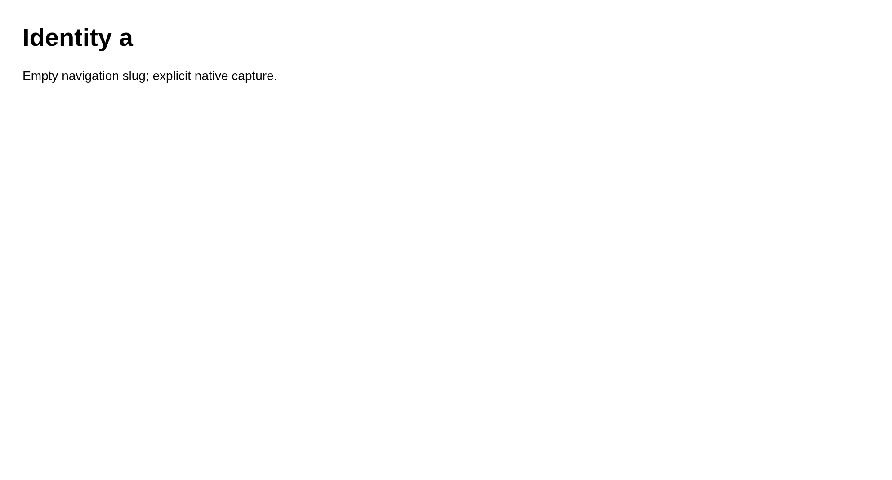

# Case a

Observe identity a

## Step a.1

Open the identity page without a screenshot

Expected: null

Observed: Page loaded.

Assertion: not-applicable

## Step a.2

Check the exact identity

Expected: {"text":"Identity a","visible":null,"url":null}

Observed: Found text: Identity a

Assertion: passed

## Step a.3

Capture the visible heading

Expected: null

Observed: Read: Identity a

Assertion: not-applicable

Limits: Capture time and viewport are unknown when the driver did not record them.; Only executed expect evidence with assertionPassed=true can establish a passing assertion.; Video is unavailable with the Surf driver. Image captures remain valid.

