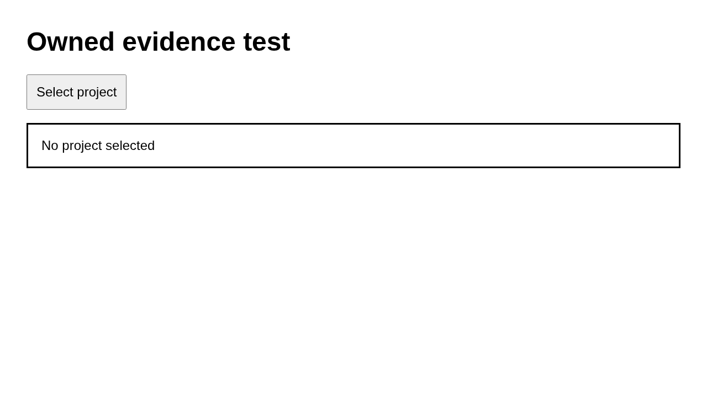

# Case capture

Keep a capture separate from an assertion

## Step capture.1

Capture the owned page without an assertion

Expected: null

Observed: Page loaded.

Assertion: not-applicable

Limits: Capture time and viewport are unknown when the driver did not record them.; Only executed expect evidence with assertionPassed=true can establish a passing assertion.

