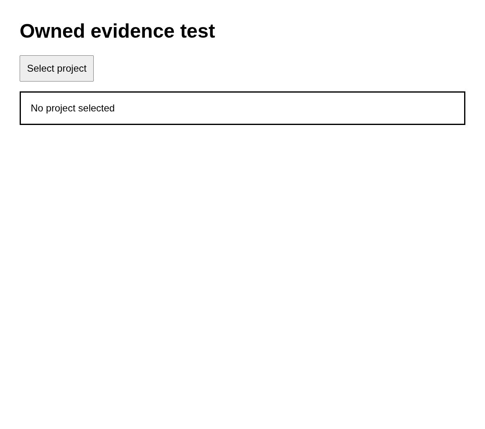

# Case a

Preserve identity a

## Step a.1

Open the case-specific page without a screenshot

Expected: null

Observed: Page loaded.

Assertion: not-applicable

## Step a.2

Check the case-specific URL

Expected: {"text":null,"visible":null,"url":"case=a$"}

Observed: Captured before expect.; URL matched: http://127.0.0.1:37361/?case=a

Assertion: passed

## Step a.3

Capture the case-specific heading

Expected: null

Observed: Read: Owned evidence test

Assertion: not-applicable

Limits: Capture time and viewport are unknown when the driver did not record them.; Only executed expect evidence with assertionPassed=true can establish a passing assertion.; Video is unavailable with the Surf driver. Image captures remain valid.

