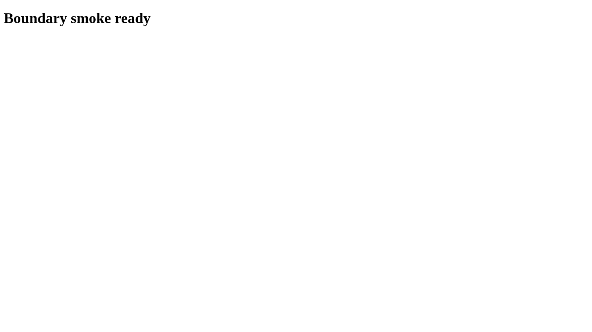

# Case case

Check the owned heading

## Step case.1

Open the owned page

Expected: null

Observed: Page loaded.

Assertion: not-applicable

## Step case.2

Check the heading

Expected: {"text":"Boundary smoke ready","visible":null,"url":null}

Observed: Captured before expect.; Found text: Boundary smoke ready

Assertion: passed

Limits: Capture time and viewport are unknown when the driver did not record them.; Only executed expect evidence with assertionPassed=true can establish a passing assertion.

