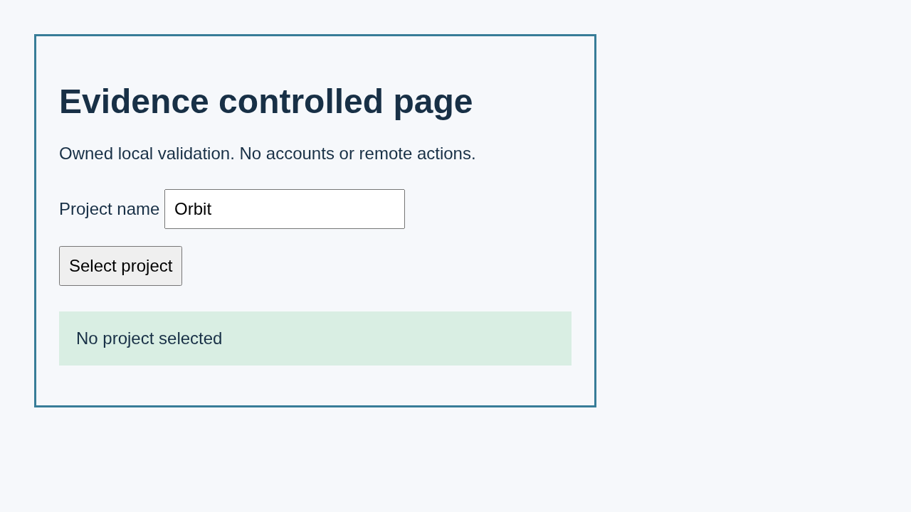
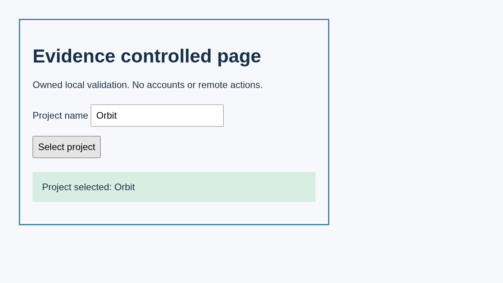

# Case 1

Record a controlled project selection

## Step 1.1

Open the controlled page

Expected: null

Observed: Page loaded.

Assertion: not-applicable

## Step 1.2

Check the initial project state

Expected: {"text":"No project selected","visible":null,"url":null}

Observed: Captured before expect.; Found text: No project selected

Assertion: passed

## Step 1.3

Select Select project

Expected: null

Observed: Clicked.

Assertion: not-applicable

## Step 1.4

Check that Orbit is selected

Expected: {"text":"Project selected: Orbit","visible":null,"url":null}

Observed: Captured before expect.; Found text: Project selected: Orbit

Assertion: passed

[Case recording](media/step-001-case-recording--capture-001.webm)

Limits: Capture time and viewport are unknown when the driver did not record them.; Only executed expect evidence with assertionPassed=true can establish a passing assertion.

