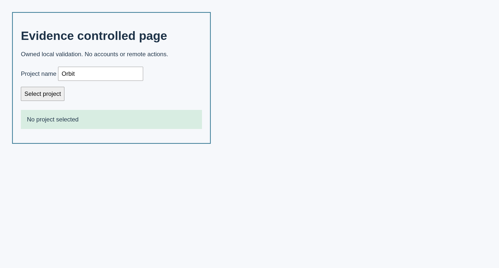

# Case 1

Select a named project on the controlled page

## Step 1.1

Open the controlled page

Expected: null

Observed: Page loaded.

Assertion: not-applicable

## Step 1.2

Check the page heading

Expected: {"text":"Evidence controlled page","visible":null,"url":null}

Observed: Captured before expect.; Found text: Evidence controlled page

Assertion: passed

## Step 1.3

Set Project name to Aurora

Expected: null

Observed: Typed.

Assertion: not-applicable

## Step 1.4

Select Select project

Expected: null

Observed: Clicked.

Assertion: not-applicable

## Step 1.5

Check that Aurora is selected

Expected: {"text":"Project selected: Aurora","visible":null,"url":null}

Observed: Captured before expect.; Found text: Project selected: Aurora

Assertion: passed

Limits: Capture time and viewport are unknown when the driver did not record them.; Only executed expect evidence with assertionPassed=true can establish a passing assertion.; Video is unavailable with the Surf driver. Image captures remain valid.

