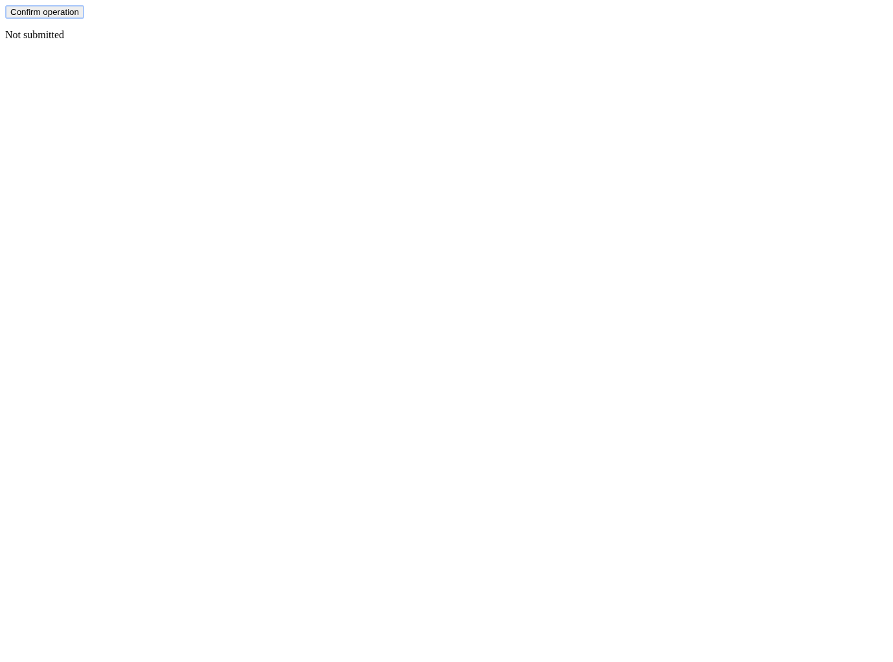

# Case approved-space

Permit approved keyboard confirmation

## Step approved-space.1

Open the confirmation page

Expected: null

Observed: Page loaded.

Assertion: not-applicable

## Step approved-space.2

Activate the approved confirmation

Expected: null

Observed: Pressed Space.

Assertion: not-applicable

## Step approved-space.3

Check submission

Expected: {"text":"Submitted","visible":null,"url":null}

Observed: Error: ASSERT FAIL approved-space.3: expected Submitted, got Not submitted
    at <anonymous>:2:246
    at tick (<anonymous>:2:327)

Assertion: failed

Limits: Capture time and viewport are unknown when the driver did not record them.; Only executed expect evidence with assertionPassed=true can establish a passing assertion.; Video is unavailable with the Surf driver. Image captures remain valid.

