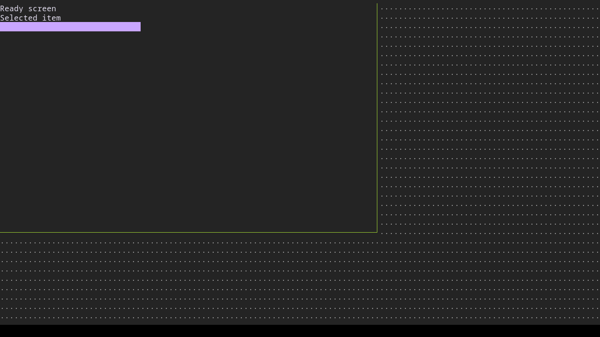

# Case transition

Native delayed screen transition

## Step transition.1

Inspect the ready screen.

Expected: {"text":"Ready screen","visible":null,"url":null}

Observed: Expected screen, native dimensions, colour probes and text line positions match

Assertion: passed

## Step transition.2

Open details.

Expected: null

Observed: Input completed on the owned terminal

Assertion: not-applicable

## Step transition.3

Inspect the delayed details screen.

Expected: {"text":"Details screen","visible":null,"url":null}

Observed: Expected screen, native dimensions, colour probes and text line positions match

Assertion: passed

Limits: Native video is unavailable.; OCR and stable frame hashes check visible content, not usability. Inspect every original PNG.; The private headless display does not reproduce a borrowed desktop terminal.; Font metrics and output dimensions depend on installed foot/wlroots/fonts; explicit image expectations must match.

