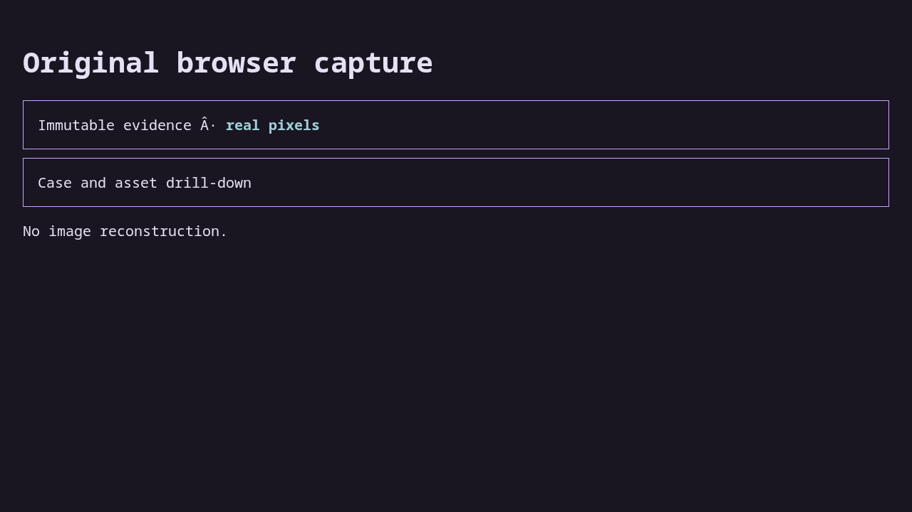

# Case case-12

Inspect original evidence 12

## Step case-12.1

Open the owned page

Expected: null

Observed: Page loaded.

Assertion: not-applicable

## Step case-12.2

Read the original heading

Expected: {"text":"Original browser capture","visible":null,"url":null}

Observed: Captured before expect.; Found text: Original browser capture

Assertion: passed

Limits: Capture time and viewport are unknown when the driver did not record them.; Only executed expect evidence with assertionPassed=true can establish a passing assertion.

