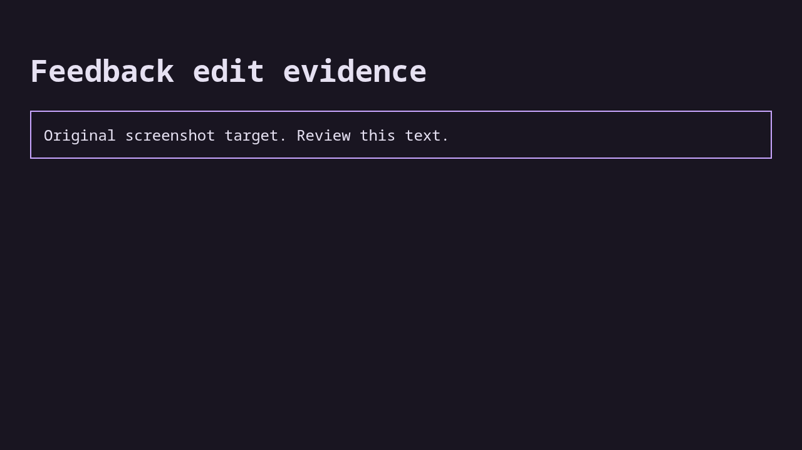

# Case original

Inspect screenshot

## Step original.1

Open owned page

Expected: null

Observed: Page loaded.

Assertion: not-applicable

## Step original.2

Read heading

Expected: {"text":"Feedback edit evidence","visible":null,"url":null}

Observed: Captured before expect.; Found text: Feedback edit evidence

Assertion: passed

Limits: Capture time and viewport are unknown when the driver did not record them.; Only executed expect evidence with assertionPassed=true can establish a passing assertion.

