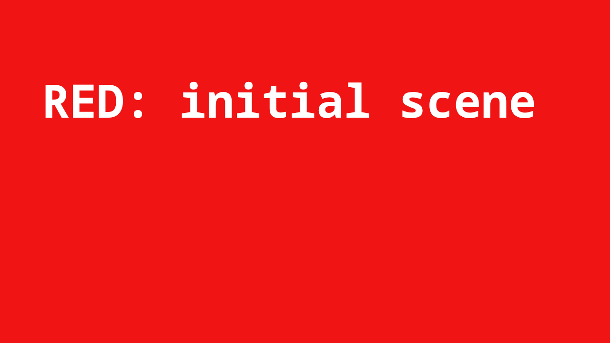
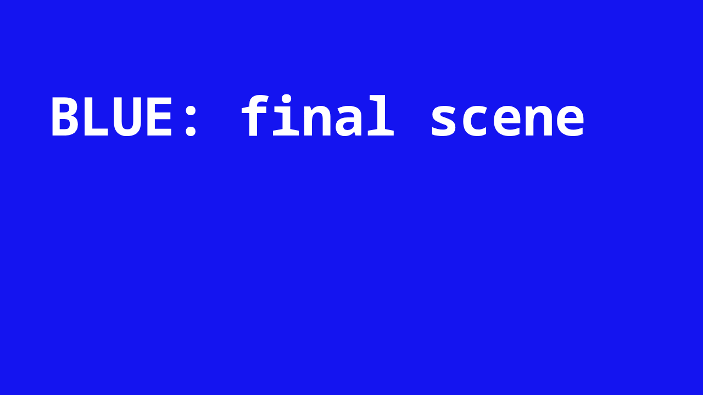

# Case sequence

Observe red then blue page transition

## Step sequence.1

Open red scene

Expected: null

Observed: Page loaded.

Assertion: not-applicable

## Step sequence.2

Wait for blue scene

Expected: null

Observed: Rendered.

Assertion: not-applicable

## Step sequence.3

Read blue scene

Expected: {"text":"BLUE: final scene","visible":null,"url":null}

Observed: Captured before expect.; Found text: BLUE: final scene

Assertion: passed

[Case recording](media/step-001-case-recording--capture-001.webm)

Limits: Capture time and viewport are unknown when the driver did not record them.; Only executed expect evidence with assertionPassed=true can establish a passing assertion.

