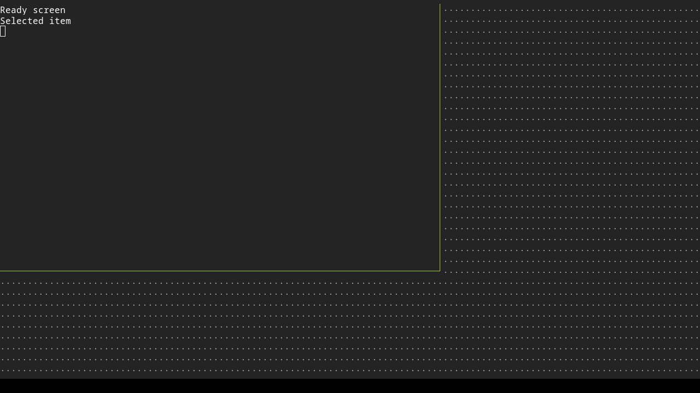

# Case assertion

Inspect owned native fixture

## Step assertion.1

Check real terminal dimensions against deliberately wrong width.

Expected: {"text":"Ready screen","visible":null,"url":null}

Observed: Native image dimensions do not match the expected display

Assertion: failed

Limits: Native video is unavailable.; OCR and stable frame hashes check visible content, not usability. Inspect every original PNG.; The private headless display does not reproduce a borrowed desktop terminal.; Font metrics and output dimensions depend on installed foot/wlroots/fonts; explicit image expectations must match.

