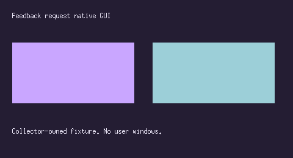

# Case scene

Inspect the owned native GUI fixture

## Step scene.1

Inspect the selected window.

Expected: {"text":null,"visible":true,"url":null,"image":{"width":481,"height":260,"pixels":[{"x":40,"y":110,"rgb":[201,166,255]},{"x":270,"y":110,"rgb":[156,207,216]}],"lines":[]}}

Observed: Native GUI frame did not settle on the expected dimensions and RGB probes before timeout

Assertion: failed

Limits: Native video and automated GUI input are unavailable.; Only Linux X11 is supported. Wayland portals, macOS and Windows are not implemented.; Pixel probes and stable frames do not prove usability or absence of private content. Inspect every original PNG.; Keep the selected window unobscured; X11 capture can include occlusion. Display root captures include the whole approved display.

