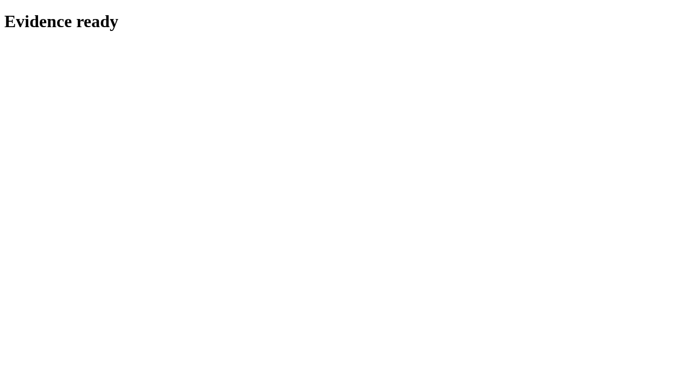

# Case ready

Inspect the controlled page

## Step ready.1

Open the controlled page.

Expected: null

Observed: Page loaded.

Assertion: not-applicable

## Step ready.2

Read the ready heading.

Expected: {"text":"Evidence ready","visible":true,"url":null}

Observed: Captured before expect.; Found text: Evidence ready

Assertion: passed

Limits: Capture time and viewport are unknown when the driver did not record them.; Only executed expect evidence with assertionPassed=true can establish a passing assertion.

