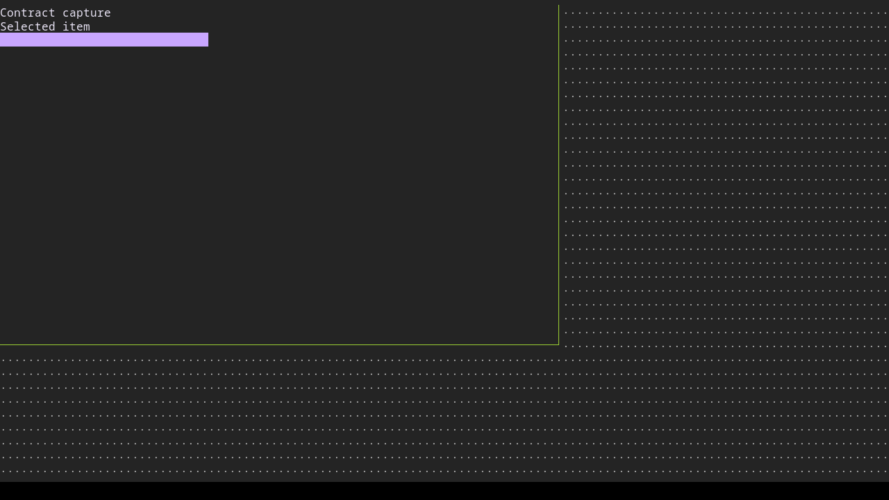

# Case current

Capture a real private terminal under the current contract

## Step current.1

Read the contract capture screen.

Expected: {"text":"Contract capture","visible":null,"url":null}

Observed: Expected screen, native dimensions, colour probes and text line positions match

Assertion: passed

Limits: Native video is unavailable.; OCR and stable frame hashes check visible content, not usability. Inspect every original PNG.; The private headless display does not reproduce a borrowed desktop terminal.; Font metrics and output dimensions depend on installed foot/wlroots/fonts; explicit image expectations must match.

